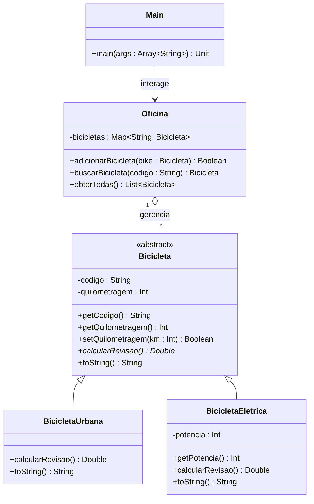

# [TRAIN] Oficina de Bicicletas

<!-- toc-table -->


## Intro

Em meio ao trânsito caótico da metrópole, Carlos abriu a *CicloTech*, uma oficina especializada em atender desde ciclistas urbanos tradicionais até adeptos das modernas bicicletas elétricas. No início, o controle das ordens de serviço era feito em um caderno amassado, mas logo surgiram problemas: revisões de e-bikes cobradas com preço de urbana causavam prejuízos com manutenção de motores potentes, enquanto clientes reclamavam de quilometragens anotadas com valores negativos por distração dos mecânicos.

Para profissionalizar o negócio, Carlos decidiu encomendar um sistema orientado a objetos robusto. Cada bicicleta que entra na oficina recebe uma identificação única e tem sua quilometragem registrada sob rigoroso controle de invariante. Além disso, a cobrança da revisão é calculada de forma polimórfica: bicicletas urbanas pagam uma taxa fixa simples acrescida por quilômetro rodado, enquanto bicicletas elétricas consideram também a potência do motor para cobrir o desgaste elétrico.

O sistema é composto pelas seguintes classes e responsabilidades:

1. **`Bicicleta`** (Classe Abstrata):
   - Atributos:
     - `codigo` (`String`): Identificador único da bicicleta.
     - `quilometragem` (`Int`): Distância percorrida em quilômetros (deve ser $\ge 0$).
   - Construtor: Inicializa `codigo` e `quilometragem`.
   - Métodos:
     - `getCodigo(): String`: Retorna o código identificador.
     - `getQuilometragem(): Int`: Retorna a quilometragem atual.
     - `setQuilometragem(km: Int): Boolean`: Atualiza a quilometragem apenas se $km \ge 0$, retornando `true` em sucesso e `false` se o valor for inválido, preservando o estado anterior.
     - `calcularRevisao(): Double` (abstrato): Calcula o custo total da revisão.

2. **`BicicletaUrbana`** (Subclasse de `Bicicleta`):
   - Construtor: Recebe `codigo` e `quilometragem`.
   - Métodos:
     - `calcularRevisao(): Double`: Retorna a taxa base de R$ 50.00 mais R$ 0.10 por quilômetro rodado.
     - `toString(): String`: Retorna a representação formatada no padrão:  
       `"urbana: <codigo>, km: <quilometragem>, cost: <calcularRevisao()>"`

3. **`BicicletaEletrica`** (Subclasse de `Bicicleta`):
   - Atributos adicionais:
     - `potencia` (`Int`): Potência do motor em Watts.
   - Construtor: Recebe `codigo`, `quilometragem` e `potencia`.
   - Métodos:
     - `getPotencia(): Int`: Retorna a potência do motor.
     - `calcularRevisao(): Double`: Retorna a taxa base de R$ 100.00 mais R$ 0.20 por quilômetro rodado, acrescido de uma taxa extra de R$ 50.00 caso a potência seja estritamente superior a 250W.
     - `toString(): String`: Retorna a representação formatada no padrão:  
       `"eletrica: <codigo>, km: <quilometragem>, potencia: <potencia>W, cost: <calcularRevisao()>"`

4. **`Oficina`** (Classe de Gerenciamento):
   - Atributos:
     - `bicicletas` (`Map<String, Bicicleta>`): Armazena as bicicletas cadastradas tendo o código como chave. Recomenda-se o uso de mapa ordenado (`sortedMapOf` ou ordenação por chave na listagem) para garantir saída consistente.
   - Métodos:
     - `adicionarBicicleta(bike: Bicicleta): Boolean`: Insere a bicicleta no mapa se o código ainda não existir, retornando `true`; se já existir, retorna `false`.
     - `buscarBicicleta(codigo: String): Bicicleta?`: Retorna a bicicleta associada ao código ou `null` caso não encontrada.
     - `obterTodas(): List<Bicicleta>`: Retorna a lista com todas as bicicletas cadastradas ordenadas alfabeticamente pelo código.

## Regras

- O código da bicicleta é a chave única no mapa da oficina; cadastrar um código já existente deve falhar e o sistema deve exibir `fail: bike already exists`.
- A quilometragem de uma bicicleta não pode ser negativa; chamadas a `setQuilometragem` com valor menor que 0 devem falhar retornando `false` e mantendo inalterado o valor anterior.
- Bicicletas urbanas cobram taxa base de R$ 50.00 acrescida de R$ 0.10 por km rodado.
- Bicicletas elétricas cobram taxa base de R$ 100.00 mais R$ 0.20 por km rodado, além de um adicional de R$ 50.00 se a potência for maior que 250W.
- Operações de busca ou alteração em bicicletas inexistentes no mapa devem exibir `fail: bike not found`.
- O comando de listagem geral em uma oficina sem bicicletas cadastradas deve exibir `fail: empty workshop`.
- As classes de domínio nunca realizam saídas de texto diretamente (`println`); elas retornam valores (`Boolean`, objetos, `null`) para que o `Main` faça o tratamento e exibição.

## Diagrama



## Guide

* Comece criando a classe abstrata `Bicicleta`. Garanta que o atributo `quilometragem` seja privado e que o método `setQuilometragem(km: Int): Boolean` valide a invariante ($km \ge 0$), retornando `false` sem alterar o valor em caso de entrada negativa.
* Implemente as classes `BicicletaUrbana` e `BicicletaEletrica` estendendo `Bicicleta`. Sobrescreva `calcularRevisao(): Double` aplicando as regras de precificação de cada modalidade e implemente o método `toString()` de cada uma conforme a especificação.
* Crie a classe `Oficina` encapsulando uma coleção do tipo `Map<String, Bicicleta>`. Implemente os métodos de inserção verificando a existência da chave (`containsKey`), de busca direta e de recuperação de todas as bicicletas com ordenação pela chave.
* Monte a função `main` processando os comandos a partir da entrada padrão (`Scanner` ou `readLine`). Trate os retornos dos métodos da oficina e imprima as mensagens de sucesso ou falha correspondentes.

Perguntas de reflexão:
- Por que delegar a responsabilidade do cálculo de revisão para cada subclasse (`BicicletaUrbana` e `BicicletaEletrica`) através do polimorfismo é superior a verificar o tipo da bicicleta com operadores como `is` ou `when` dentro da classe `Oficina`?
- Como o retorno booleano no setter `setQuilometragem` auxilia a camada de apresentação (`Main`) a comunicar erros sem que o domínio precise acoplar dependências de saída (`System.out`)?

## Shell

```bash
#TEST_CASE cadastro_e_unicidade

$add_urbana b1 1200
success
$add_eletrica b2 500 350
success
$add_urbana b1 200
fail: bike already exists
$end
```

```bash
#TEST_CASE encapsulamento_e_invariante

$add_urbana b1 1000
success
$set_km b1 -50
fail: invalid km
$set_km b1 1500
success
$show b1
urbana: b1, km: 1500, cost: 200.0
$end
```

```bash
#TEST_CASE revisao_polimorfica_eletrica

$add_eletrica e1 200 300
success
$show e1
eletrica: e1, km: 200, potencia: 300W, cost: 190.0
$add_eletrica e2 200 250
success
$show e2
eletrica: e2, km: 200, potencia: 250W, cost: 140.0
$end
```

```bash
#TEST_CASE elementos_inexistentes

$show b99
fail: bike not found
$set_km b99 100
fail: bike not found
$end
```

```bash
#TEST_CASE listagem_geral_e_oficina_vazia

$show_all
fail: empty workshop
$add_urbana u1 100
success
$add_eletrica e1 400 250
success
$show_all
eletrica: e1, km: 400, potencia: 250W, cost: 180.0
urbana: u1, km: 100, cost: 60.0
$end
```

<!-- MERMAID -->