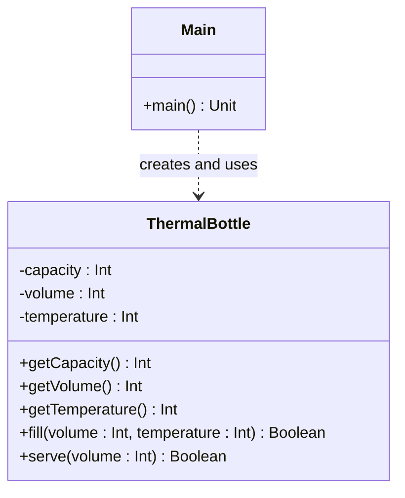

# [TRAIN] Garrafa Térmica Inteligente

<!-- toc-table -->


## Intro

Na startup *ThermoTech Solutions*, a engenheira Mariana e o desenvolvedor Carlos foram encarregados de criar o firmware da **SmartBottle 3000**, uma garrafa térmica inteligente conectada. No último teste de laboratório, um erro grotesco no software antigo permitiu que o usuário solicitasse um enchimento além da capacidade física do recipiente, resultando em um vazamento que quase queimou a placa controladora. Para piorar, leituras corrompidas de sensores enviavam volumes negativos, deixando o painel completamente dessincronizado.

Mariana definiu a tarefa: Carlos precisa recriar o núcleo lógico da garrafa utilizando **Programação Orientada a Objetos com Encapsulamento estrito**. Os atributos de capacidade, volume e temperatura não devem ser manipulados diretamente por agentes externos. O objeto deve garantir suas **invariantes** a todo custo: o volume nunca pode ser negativo nem ultrapassar a capacidade máxima, e a temperatura não pode assumir valores inconsistentes.

### Atributos e Estrutura

- **ThermalBottle**:
  - `capacity` (Int, privado): capacidade máxima suportada em mililitros (mL).
  - `volume` (Int, privado): quantidade atual de líquido armazenada em mL.
  - `temperature` (Int, privado): temperatura atual do líquido em graus Celsius (°C).
- **Construtor**:
  - `ThermalBottle(capacity: Int)`: inicializa a garrafa com a capacidade fornecida. Inicialmente, o volume é `0` e a temperatura é `0`.
- **Métodos**:
  - `getCapacity(): Int`: retorna a capacidade máxima.
  - `getVolume(): Int`: retorna o volume de líquido atual.
  - `getTemperature(): Int`: retorna a temperatura atual.
  - `fill(volume: Int, temperature: Int): Boolean`: adiciona o volume informado e define a nova temperatura se a operação for válida (sem ultrapassar a capacidade e sem parâmetros negativos). Retorna `true` se abasteceu com sucesso, ou `false` se os dados forem inválidos ou causarem transbordamento.
  - `serve(volume: Int): Boolean`: retira o volume informado da garrafa. Retorna `true` em caso de sucesso ou `false` se o volume for negativo ou superior ao volume existente.

### Comandos do Shell

O programa lê comandos em loop a partir da entrada padrão:

- `init <capacity>`: cria uma nova garrafa térmica com a capacidade informada. Se a capacidade for menor ou igual a zero, exibe `fail: capacity must be positive`.
- `show`: exibe o estado atual da garrafa no formato: `capacity: C, volume: V, temperature: T`.
- `fill <volume> <temperature>`: abastece a garrafa. Em caso de parâmetro negativo, exibe `fail: negative value`. Em caso de volume excedente à capacidade disponível, exibe `fail: overflow`.
- `serve <volume>`: retira líquido da garrafa. Se o volume for negativo, exibe `fail: negative value`. Se o volume solicitado for maior que o volume disponível, exibe `fail: not enough water`.
- `end`: encerra o programa.

## Regras

- A capacidade informada na criação da garrafa deve ser estritamente maior que zero (`capacity > 0`).
- O volume atual nunca pode ser menor que zero nem maior que a capacidade (`0 <= volume <= capacity`).
- Ao abastecer (`fill`), valores negativos para volume ou temperatura devem ser rejeitados e não alteram o estado da garrafa.
- Se uma tentativa de abastecer resultar em transbordamento (`volume + atual > capacity`), a operação deve ser cancelada integralmente, preservando o volume e a temperatura anteriores.
- Ao servir (`serve`), valores negativos devem ser rejeitados. Se não houver água suficiente para a dose solicitada, nenhuma quantidade de água deve ser retirada.
- Se o volume esvaziar totalmente (`volume == 0`), a temperatura é resetada para `0`.
- As classes do domínio (`ThermalBottle`) não devem conter comandos de impressão (`println`); o controle de exibição de erros (`fail: ...`) pertence à camada Shell/Main.

## Diagrama



## Guide

* **Passo 1 (Encapsulamento e Estado Inicial):** Crie a classe `ThermalBottle` com propriedades privadas `capacity`, `volume` e `temperature`. No construtor, assegure-se de que a capacidade seja positiva (caso use exceções ou validação prévia na Main). Disponibilize os métodos getters para leitura dos atributos.
* **Passo 2 (Operação de Abastecimento - Invariante de Transbordamento):** Implemente `fill(volume: Int, temperature: Int): Boolean`. Verifique primeiro se algum parâmetro é negativo. Em seguida, verifique se `this.volume + volume > this.capacity`. Se qualquer condição falhar, mantenha o estado anterior intacto e retorne `false`. Caso contrário, atualize `this.volume` e `this.temperature` e retorne `true`.
* **Passo 3 (Operação de Servir - Invariante de Não Negatividade):** Implemente `serve(volume: Int): Boolean`. Garanta que `volume >= 0` e que `volume <= this.volume`. Se válido, subtraia o volume. Se a garrafa ficar completamente vazia (`this.volume == 0`), zere a temperatura. Retorne `true` ou `false` conforme o sucesso da operação.
* **Passo 4 (Shell e Tratamento de Erros):** Na função `main`, instancie o objeto e monte o loop de comandos. Lembre-se de mapear as razões de falha e imprimir as mensagens `fail: ...` adequadas antes ou após a interação com o domínio, mantendo a classe `ThermalBottle` livre de chamadas de console.

Perguntas de reflexão:
1. Por que manter o estado inalterado em caso de transbordamento (atomicidade da operação) é crucial para sistemas embarcados?
2. Como o uso de visibilidade privada (`private`) nos atributos impede que código cliente quebre regras de negócio fundamentais da garrafa?

## Shell

```bash
#TEST_CASE inicializacao_e_show

$init 1000
$show
capacity: 1000, volume: 0, temperature: 0
$end
```

```bash
#TEST_CASE capacidade_invalida

$init 0
fail: capacity must be positive
$init -500
fail: capacity must be positive
$end
```

```bash
#TEST_CASE abastecimento_valido

$init 1000
$fill 500 85
$show
capacity: 1000, volume: 500, temperature: 85
$fill 300 70
$show
capacity: 1000, volume: 800, temperature: 70
$end
```

```bash
#TEST_CASE falhas_de_abastecimento

$init 1000
$fill -50 80
fail: negative value
$fill 500 -10
fail: negative value
$fill 1200 90
fail: overflow
$show
capacity: 1000, volume: 0, temperature: 0
$end
```

```bash
#TEST_CASE servir_liquido_e_limites

$init 1000
$fill 600 90
$serve -30
fail: negative value
$serve 700
fail: not enough water
$show
capacity: 1000, volume: 600, temperature: 90
$serve 600
$show
capacity: 1000, volume: 0, temperature: 0
$end
```

```bash
#TEST_CASE sequencia_completa

$init 500
$fill 500 95
$show
capacity: 500, volume: 500, temperature: 95
$fill 1 95
fail: overflow
$serve 250
$show
capacity: 500, volume: 250, temperature: 95
$serve 250
$show
capacity: 500, volume: 0, temperature: 0
$serve 1
fail: not enough water
$end