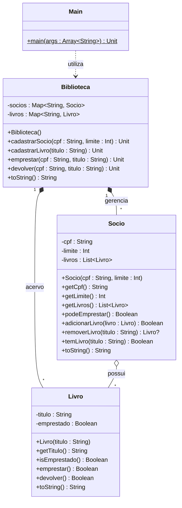

# [TRAIN] Biblioteca de Bairro

<!-- toc-table -->


## Intro

Dona Clara é a zelosa coordenadora da Biblioteca Popular da Vila das Flores, um espaço comunitário mantido com doações de livros para incentivar a leitura entre jovens e adultos do bairro. Durante anos, todo o controle foi feito em um velho caderno espiral: anotações de quem pegou qual livro, datas improvisadas e rasuras nas margens. Recentemente, com o aumento no número de leitores e o sumiço de obras raras, a situação ficou insustentável: sócios pegavam mais livros do que podiam cuidar e outros tentavam retirar títulos que já estavam emprestados.

Para resolver de vez o descontrole, Dona Clara pediu sua ajuda para construir um sistema em Kotlin robusto e seguro. O sistema deve impedir que as regras do negócio sejam violadas por meio de encapsulamento rígido e sinalização de falhas via exceções.

O sistema é estruturado em três classes de domínio:

- **`Livro`**: Representa uma obra literária do acervo.
  - Atributos: `titulo` (String) e `emprestado` (Boolean, privado com alteração restrita).
  - Construtor: recebe o título da obra e inicializa seu estado como não emprestado (`false`).
  - Métodos:
    - `getTitulo(): String`: retorna o título do livro.
    - `isEmprestado(): Boolean`: indica se a obra está atualmente emprestada.
    - `emprestar(): Boolean`: se o livro já estiver emprestado, retorna `false`; caso contrário, marca como emprestado e retorna `true`.
    - `devolver(): Boolean`: se o livro não estiver emprestado, retorna `false`; caso contrário, marca como não emprestado e retorna `true`.
    - `toString(): String`: formata a representação textual do livro (ex.: `Dom_Casmurro [disponivel]` ou `Dom_Casmurro [emprestado]`).

- **`Socio`**: Representa um membro cadastrado da biblioteca.
  - Atributos: `cpf` (String), `limite` (Int, quantidade máxima de livros simultâneos) e `livros` (MutableList privada de livros atualmente em posse do sócio).
  - Construtor: recebe o CPF e o limite máximo de livros.
  - Métodos:
    - `getCpf(): String`: retorna o CPF do sócio.
    - `getLimite(): Int`: retorna o limite de empréstimos.
    - `getLivros(): List<Livro>`: retorna uma visualização imutável da lista de livros emprestados.
    - `podeEmprestar(): Boolean`: retorna `true` se o número de livros emprestados for estritamente menor que o limite.
    - `adicionarLivro(livro: Livro): Boolean`: adiciona o livro se `podeEmprestar()` for verdadeiro, retornando `true`; caso contrário, retorna `false`.
    - `removerLivro(titulo: String): Livro?`: se o sócio estiver com o livro de determinado título, remove-o e o retorna; caso contrário, retorna `null`.
    - `temLivro(titulo: String): Boolean`: verifica se o sócio possui atualmente o livro com o título informado.
    - `toString(): String`: formata o sócio no padrão `socio: <cpf> [limite: <limite>, emprestados: [<titulo1>, <titulo2>]]`.

- **`Biblioteca`**: Responsável por orquestrar os cadastros e as regras de negócio.
  - Atributos: `socios` (Map indexado pelo CPF) e `livros` (Map indexado pelo título).
  - Construtor: inicializa os mapas de sócios e livros vazios (usando coleções que preservam a ordem de inserção).
  - Métodos:
    - `cadastrarSocio(cpf: String, limite: Int)`: cadastra um novo sócio. Lança `IllegalArgumentException("socio already exists")` se o CPF já estiver cadastrado.
    - `cadastrarLivro(titulo: String)`: cadastra um novo livro no acervo. Lança `IllegalArgumentException("livro already exists")` se já houver obra com aquele título.
    - `emprestar(cpf: String, titulo: String)`:
      - Lança `IllegalArgumentException("socio nao encontrado")` se o sócio não existir.
      - Lança `IllegalArgumentException("livro nao encontrado")` se o livro não existir no acervo.
      - Lança `IllegalStateException("livro indisponivel")` se o livro já estiver emprestado.
      - Lança `IllegalStateException("limite de emprestimos excedido")` se o sócio tiver atingido seu limite.
      - Caso todas as condições sejam atendidas, atualiza o estado do livro e insere-o na lista do sócio.
    - `devolver(cpf: String, titulo: String)`:
      - Lança `IllegalArgumentException("socio nao encontrado")` se o sócio não existir.
      - Lança `IllegalArgumentException("livro nao encontrado")` se o livro não existir no acervo.
      - Lança `IllegalStateException("socio nao possui este livro")` se o sócio não estiver em posse da obra informada.
      - Caso válido, remove o livro da posse do sócio e marca o livro como disponível.
    - `toString(): String`: lista todos os sócios (um por linha) e, em seguida, todos os livros do acervo (um por linha). Se não houver itens, nada é impresso nessa respectiva seção.

- **Shell / `Main`**:
  - Lê comandos do terminal, executa as operações e captura exceções imprimindo `fail: <mensagem>`.
  - Comandos que realizam mutação com sucesso executam de forma silenciosa.

## Regras

- O acervo e os sócios devem ser armazenados internamente na `Biblioteca` utilizando estruturas de mapa (`Map`).
- A ordem de inserção dos sócios e livros deve ser preservada na listagem (`LinkedHashMap`).
- Nenhuma classe de modelo (`Livro`, `Socio`, `Biblioteca`) deve imprimir mensagens diretamente no console.
- A invariante do sócio não pode ser violada: o total de empréstimos ativos nunca pode exceder o seu limite.
- A biblioteca deve lançar `IllegalArgumentException` para cadastros duplicados ou entidades não encontradas.
- A biblioteca deve lançar `IllegalStateException` para violações de estado operacional (livro indisponível, limite atingido ou livro não associado ao sócio).
- Falhas capturadas pelo Shell devem ser exibidas obrigatoriamente com o prefixo `fail: `.

## Diagrama



## Guide

* **Passo 1 (`Livro`)**: Crie a classe `Livro` com o atributo `titulo` imutável e a flag `emprestado` com visibilidade privada para alteração (`private set`). Implemente os métodos `emprestar()` e `devolver()`, garantindo que alterem a flag e retornem `true` apenas se a transição de estado for viável.
* **Passo 2 (`Socio`)**: Crie a classe `Socio` mantendo a lista interna de livros privada. O método `getLivros()` deve retornar uma referência de leitura imutável (`toList()`). Certifique-se de que `adicionarLivro()` consulte `podeEmprestar()` antes de aceitar uma nova obra, protegendo a invariante do limite de empréstimos.
* **Passo 3 (`Biblioteca`)**: Crie a classe `Biblioteca` utilizando `mutableMapOf<String, Socio>()` e `mutableMapOf<String, Livro>()`. No método `emprestar()`, valide as quatro condições na ordem estipulada (existência de sócio, existência de livro, disponibilidade do livro e capacidade do sócio), disparando as exceções adequadas (`IllegalArgumentException` e `IllegalStateException`).
* **Passo 4 (`Main`)**: Monte o laço interativo do Shell. Utilize um bloco `try / catch (e: Exception)` ao redor do processamento de cada linha para capturar as exceções das regras de negócio e exibir `fail: ${e.message}`. Adicione o comando `show` para invocar o `toString()` da biblioteca.

Perguntas de reflexão:
1. Por que a responsabilidade de lançar exceções com mensagens de negócio ficou na classe `Biblioteca`, enquanto `Livro` e `Socio` retornam booleanos ou nulos em suas operações atômicas?
2. Como a utilização de mapas (`Map`) por chave primária (CPF e título) altera a complexidade de tempo de busca em relação a uma busca linear em listas?

## Shell

```bash
#TEST_CASE cadastro_e_exibicao

$show
$add_socio 111 2
$add_socio 222 1
$add_livro Dom_Casmurro
$add_livro O_Hobbit
$show
socio: 111 [limite: 2, emprestados: []]
socio: 222 [limite: 1, emprestados: []]
livro: Dom_Casmurro [disponivel]
livro: O_Hobbit [disponivel]
$end
```

```bash
#TEST_CASE duplicidade_e_preservacao

$add_socio 111 2
$add_socio 111 3
fail: socio already exists
$add_livro Dom_Casmurro
$add_livro Dom_Casmurro
fail: livro already exists
$show
socio: 111 [limite: 2, emprestados: []]
livro: Dom_Casmurro [disponivel]
$end
```

```bash
#TEST_CASE fluxo_emprestimo_e_devolucao

$add_socio 111 2
$add_livro Dom_Casmurro
$add_livro O_Hobbit
$emprestar 111 Dom_Casmurro
$show
socio: 111 [limite: 2, emprestados: [Dom_Casmurro]]
livro: Dom_Casmurro [emprestado]
livro: O_Hobbit [disponivel]
$devolver 111 Dom_Casmurro
$show
socio: 111 [limite: 2, emprestados: []]
livro: Dom_Casmurro [disponivel]
livro: O_Hobbit [disponivel]
$end
```

```bash
#TEST_CASE falhas_de_entidade_e_disponibilidade

$add_socio 111 2
$add_socio 222 2
$add_livro O_Hobbit
$emprestar 999 O_Hobbit
fail: socio nao encontrado
$emprestar 111 Livro_Fantasma
fail: livro nao encontrado
$emprestar 111 O_Hobbit
$emprestar 222 O_Hobbit
fail: livro indisponivel
$show
socio: 111 [limite: 2, emprestados: [O_Hobbit]]
socio: 222 [limite: 2, emprestados: []]
livro: O_Hobbit [emprestado]
$end
```

```bash
#TEST_CASE limite_de_emprestimos_e_fronteira

$add_socio 333 1
$add_livro Livro_A
$add_livro Livro_B
$emprestar 333 Livro_A
$emprestar 333 Livro_B
fail: limite de emprestimos excedido
$show
socio: 333 [limite: 1, emprestados: [Livro_A]]
livro: Livro_A [emprestado]
livro: Livro_B [disponivel]
$devolver 333 Livro_A
$emprestar 333 Livro_B
$show
socio: 333 [limite: 1, emprestados: [Livro_B]]
livro: Livro_A [disponivel]
livro: Livro_B [emprestado]
$end
```

```bash
#TEST_CASE devolucao_invalida

$add_socio 111 2
$add_socio 222 2
$add_livro Livro_A
$add_livro Livro_B
$emprestar 111 Livro_A
$devolver 999 Livro_A
fail: socio nao encontrado
$devolver 111 Livro_Inexistente
fail: livro nao encontrado
$devolver 111 Livro_B
fail: socio nao possui este livro
$devolver 222 Livro_A
fail: socio nao possui este livro
$show
socio: 111 [limite: 2, emprestados: [Livro_A]]
socio: 222 [limite: 2, emprestados: []]
livro: Livro_A [emprestado]
livro: Livro_B [disponivel]
$end
```

<!-- MERMAID -->