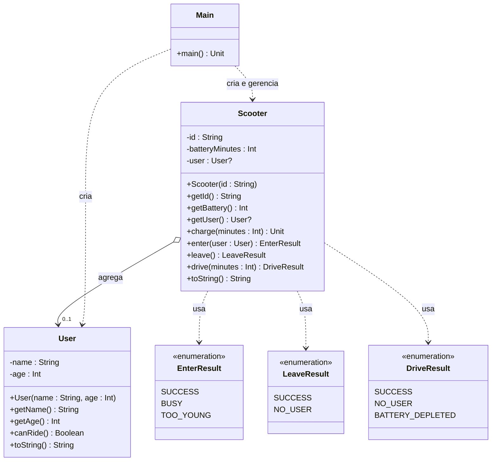

# [TRAIN] Patinete Elétrico Compartilhado

<!-- toc-table -->


## Intro

A startup de micromobilidade *EcoRide* está expandindo sua frota de patinetes elétricos pelas capitais brasileiras. Para otimizar a experiência dos usuários e garantir a segurança nas vias públicas, a engenharia de software foi encarregada de desenvolver o módulo central que orquestra os patinetes e seus condutores.

Cada patinete possui um identificador único, um medidor de bateria em minutos e pode transportar no máximo um usuário por vez. Um passageiro pode desbloquear e embarcar no patinete, realizar corridas consumindo a carga da bateria e depois desembarcar, deixando o veículo livre para o próximo cliente.

Para manter uma arquitetura coesa e desacoplada, aplicamos dois pilares essenciais da orientação a objetos:
1. **Agregação Opcional**: O `User` existe de forma independente do `Scooter`. Quando o usuário sobe ou desce do patinete, o objeto passageiro não é destruído e continua com seu estado preservado. O patinete apenas mantém uma referência opcional (`user: User?`).
2. **Delegação**: O patinete não deve conter regras específicas sobre critérios corporais ou cadastrais do passageiro. Quando alguém tenta embarcar, o patinete delega à classe `User` a validação de aptidão para condução (como a verificação de idade mínima legal de 18 anos).

### Descrição das Classes e Métodos

#### Classe `User`
Representa o cidadão que utiliza o serviço.
- **Atributos**:
  - `name: String` (privado) - Nome do usuário.
  - `age: Int` (privado) - Idade do usuário em anos.
- **Construtor**: `User(name: String, age: Int)`
- **Métodos**:
  - `getName(): String` - Retorna o nome.
  - `getAge(): Int` - Retorna a idade.
  - `canRide(): Boolean` - Retorna `true` se a idade for maior ou igual a 18 anos, ou `false` caso contrário.
  - `toString(): String` - Retorna a representação textual no formato `name:NOME, age:IDADE`.

#### Classe `Scooter`
Representa a unidade de transporte elétrico.
- **Atributos**:
  - `id: String` (privado) - Código identificador do patinete.
  - `batteryMinutes: Int` (privado) - Carga atual da bateria convertida em minutos de uso contínuo (inicia em 0).
  - `user: User?` (privado) - Referência opcional ao usuário atualmente embarcado (inicia nulo).
- **Construtor**: `Scooter(id: String)`
- **Métodos**:
  - `getId(): String` - Retorna o identificador do patinete.
  - `getBattery(): Int` - Retorna os minutos de bateria restantes.
  - `getUser(): User?` - Retorna o usuário embarcado ou `null` se vazio.
  - `charge(minutes: Int): Unit` - Adiciona minutos à bateria do patinete (apenas valores positivos).
  - `enter(user: User): EnterResult` - Embarca o usuário no patinete.
    - Se o patinete já tiver um passageiro, retorna `EnterResult.BUSY`.
    - Se o usuário não tiver idade mínima (delegando para `user.canRide()`), retorna `EnterResult.TOO_YOUNG`.
    - Se estiver apto e livre, associa o usuário e retorna `EnterResult.SUCCESS`.
  - `leave(): LeaveResult` - Desembarca o passageiro atual.
    - Se não houver ninguém, retorna `LeaveResult.NO_USER`.
    - Se houver passageiro, desassocia a referência e retorna `LeaveResult.SUCCESS`.
  - `drive(minutes: Int): DriveResult` - Realiza o percurso consumindo tempo de bateria.
    - Se não houver passageiro embarcado, retorna `DriveResult.NO_USER`.
    - Se a carga for insuficiente para cobrir os minutos solicitados (isto é, `batteryMinutes < minutes`), retorna `DriveResult.BATTERY_DEPLETED`.
    - Se houver bateria suficiente e passageiro, decrementa os minutos da bateria e retorna `DriveResult.SUCCESS`.
  - `toString(): String` - Retorna a representação textual no formato:
    - Com passageiro: `id:{id}, battery:{batteryMinutes}, user:({user})`
    - Sem passageiro: `id:{id}, battery:{batteryMinutes}, user:(empty)`

## Regras

- O patinete inicia com a bateria zerada e sem usuário embarcado.
- Apenas um usuário pode estar a bordo do patinete em um dado momento.
- A idade mínima para condução do patinete é de 18 anos.
- A validação de idade mínima deve ser delegada ao método `canRide()` da classe `User`.
- Não é possível dirigir (`drive`) sem um passageiro embarcado.
- Não é possível dirigir se a bateria restante for menor que o tempo solicitado para o trajeto.
- Se a carga de bateria for insuficiente, a bateria não é alterada e a corrida não é realizada.
- O recarregamento (`charge`) apenas incrementa minutos caso o valor informado seja maior que zero.
- As classes do domínio não imprimem mensagens no console; o tratamento de exibição e erros pertence à camada de controle (`Main`).

## Diagrama



## Guide

* Comece criando a classe `User`: defina os atributos `name` e `age`, implemente o método de delegação `canRide()` checando se a idade é maior ou igual a 18 e monte seu `toString()`.
* Crie as enumerações de resultado (`EnterResult`, `LeaveResult`, `DriveResult`) para garantir que os métodos de negócio não imprimam nada no terminal.
* Crie a classe `Scooter` com a referência anulável `var user: User? = null` e `var batteryMinutes: Int = 0`.
* Implemente o método `enter(user: User)`: cheque primeiro se já existe usuário no patinete (`user != null`), depois delegue a validação ao passageiro (`!user.canRide()`) e só então atribua a referência.
* Implemente `drive(minutes: Int)`: valide se há passageiro a bordo e se a bateria cobre todo o tempo solicitado antes de debitar os minutos.
* No `Main`, processe os comandos recebidos e mapeie os retornos das enumerações para as mensagens de falha esperadas (`fail: scooter is busy`, `fail: user too young`, `fail: no user on scooter`, `fail: battery depleted`).

Perguntas de reflexão:
1. Por que manter o ciclo de vida do `User` independente do ciclo de vida de `Scooter` caracteriza agregação e não composição?
2. Quais são as vantagens de fazer o patinete consultar `user.canRide()` em vez de verificar diretamente `user.getAge() >= 18` dentro de `Scooter`?

## Shell

```bash
#TEST_CASE inicializacao_e_exibicao

$init eco01
$show
id:eco01, battery:0, user:(empty)
$charge 20
$show
id:eco01, battery:20, user:(empty)
$end
```

```bash
#TEST_CASE embarque_e_desembarque

$init eco01
$enter Joao 25
$show
id:eco01, battery:0, user:(name:Joao, age:25)
$leave
$show
id:eco01, battery:0, user:(empty)
$leave
fail: no user on scooter
$end
```

```bash
#TEST_CASE validacao_de_idade

$init eco01
$enter Pedrinho 12
fail: user too young
$show
id:eco01, battery:0, user:(empty)
$enter Ana 17
fail: user too young
$show
id:eco01, battery:0, user:(empty)
$enter Beatriz 18
$show
id:eco01, battery:0, user:(name:Beatriz, age:18)
$end
```

```bash
#TEST_CASE patinete_ocupado

$init eco01
$enter Carlos 30
$show
id:eco01, battery:0, user:(name:Carlos, age:30)
$enter Mariana 22
fail: scooter is busy
$show
id:eco01, battery:0, user:(name:Carlos, age:30)
$end
```

```bash
#TEST_CASE corrida_e_consumo_de_bateria

$init eco01
$charge 30
$drive 10
fail: no user on scooter
$enter Marcos 28
$drive 10
$show
id:eco01, battery:20, user:(name:Marcos, age:28)
$drive 25
fail: battery depleted
$show
id:eco01, battery:20, user:(name:Marcos, age:28)
$drive 20
$show
id:eco01, battery:0, user:(name:Marcos, age:28)
$drive 1
fail: battery depleted
$end
```

```bash
#TEST_CASE fluxo_completo_multiplos_usuarios

$init eco02
$charge 50
$enter Lucas 20
$drive 15
$show
id:eco02, battery:35, user:(name:Lucas, age:20)
$leave
$show
id:eco02, battery:35, user:(empty)
$enter Diana 24
$drive 35
$show
id:eco02, battery:0, user:(name:Diana, age:24)
$leave
$show
id:eco02, battery:0, user:(empty)
$end
```

<!-- MERMAID -->