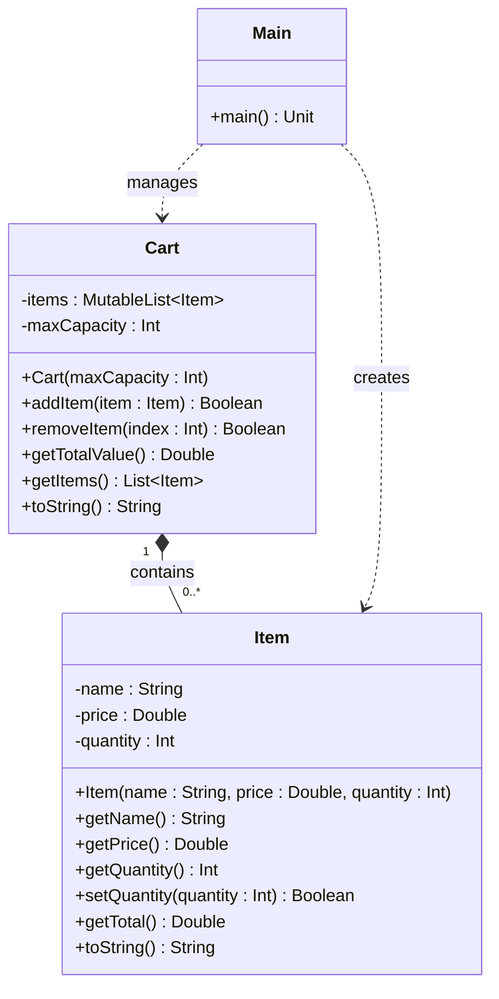

# [TRAIN] Carrinho da Padaria Artesanal

<!-- toc-table -->


## Intro

Dona Odete abriu uma padaria artesanal famosa por suas fornadas limitadas de pães de fermentação natural, croissants folhados e cafés especiais. Como os produtos são frescos e a cozinha opera sob demanda, cada cliente pode incluir apenas uma quantidade limitada de variedades no seu carrinho de pedidos de cada vez, garantindo que a equipe consiga embalar tudo no ponto certo.

Para evitar erros em que itens sejam registrados com preços zerados, quantidades nulas ou pedidos ultrapassando a capacidade do balcão de montagem, Dona Odete encomendou um sistema em Kotlin estruturado em duas classes com encapsulamento rigoroso:

- **Item**: Representa um produto adicionado ao pedido.
  - Atributos privados: `name` (String), `price` (Double) e `quantity` (Int).
  - Garante a invariante de que o preço deve ser estritamente positivo (`price > 0.0`) e a quantidade deve ser maior que zero (`quantity > 0`).
  - Métodos de acesso para leitura dos atributos, método `setQuantity(quantity: Int): Boolean` para validação de alterações, `getTotal(): Double` para o subtotal do item e `toString(): String` formatado como `nome: preco x quantidade`.

- **Cart**: Representa o carrinho de compras do cliente.
  - Atributos privados: `items` (`MutableList<Item>`) e `maxCapacity` (`Int`).
  - `addItem(item: Item): Boolean`: Adiciona o item caso a lista ainda não tenha atingido a capacidade máxima definida.
  - `removeItem(index: Int): Boolean`: Remove o item do carrinho baseado na posição indicada pela lista, retornando falso caso o índice não exista.
  - `getTotalValue(): Double`: Calcula a soma acumulada de todos os subtotais dos itens contidos.
  - `toString(): String`: Formata o resumo do carrinho como `cart: [item1, item2], total: valor`.

As classes de domínio não imprimem mensagens; elas apenas operam o estado interno e devolvem respostas booleanas ou valores calculados. O Shell (`main`) interpreta as entradas do usuário, invoca os métodos e exibe erros prefixados com `fail: ` quando alguma operação for recusada.

## Regras

- Preços e quantidades de itens devem ser estritamente maiores que zero; qualquer tentativa de criar ou alterar para valores menores ou iguais a zero é rejeitada com `fail: invalid item`.
- A capacidade máxima do carrinho é fixada na inicialização via comando `init` e não pode ser ultrapassada.
- Se o carrinho já estiver na capacidade máxima ao tentar adicionar um item válido, a operação é rejeitada com `fail: cart is full`.
- A remoção de itens deve verificar os limites do índice da coleção (`0 <= index < items.size`); tentativas com índices inválidos são rejeitadas com `fail: invalid index`.
- O valor total do carrinho deve refletir a soma exata de `price * quantity` de todos os itens cadastrados no momento.
- A lista interna de itens do carrinho deve ser protegida contra modificações externas acidentais (encapsulamento de coleção).

## Diagrama



## Guide

* **Passo 1**: Crie a classe `Item`. Defina o construtor primário com atributos privados e implemente a validação: se `price <= 0.0` ou `quantity <= 0`, lance uma exceção apropriada (ex: `IllegalArgumentException`) ou utilize um método fábrica/validador prévio. Garanta que `setQuantity` só altere o atributo se a nova quantidade for estritamente positiva.
* **Passo 2**: Implemente o método `getTotal(): Double` na classe `Item`, retornando `price * quantity`, além de sobrescrever `toString()` gerando a representação `name: price x quantity`.
* **Passo 3**: Crie a classe `Cart` contendo `private val items = mutableListOf<Item>()` e `private val maxCapacity: Int`. Implemente `addItem`, garantindo que só insira se `items.size < maxCapacity`. Implemente `removeItem` checando se `index in items.indices`.
* **Passo 4**: Implemente `getTotalValue()` utilizando funções de agregação como `.sumOf { it.getTotal() }` e implemente `toString()` formatando a lista de itens e o total acumulado.
* **Passo 5**: Construa o laço do `main` lendo os comandos via `Scanner` ou `readLine()`. Ao ler `$add`, valide o item antes; se for inválido, emita `fail: invalid item`. Se válido, tente inseri-lo no carrinho e emita `fail: cart is full` caso o carrinho atinja o limite.

Perguntas de reflexão:
1. Por que expor `getItems(): List<Item>` (visão somente leitura) é mais seguro do que expor a `MutableList<Item>` diretamente?
2. Como a separação entre validar o item e validar a lotação do carrinho facilita a manutenção e reutilização do código?

## Shell

```bash
#TEST_CASE inicializacao_e_adicao

$init 3
$add bread 5.0 2
$add coffee 10.0 1
$show
cart: [bread: 5.0 x 2, coffee: 10.0 x 1], total: 20.0
$end
```

```bash
#TEST_CASE capacidade_maxima

$init 2
$add bread 5.0 1
$add coffee 10.0 1
$add cake 20.0 1
fail: cart is full
$show
cart: [bread: 5.0 x 1, coffee: 10.0 x 1], total: 15.0
$end
```

```bash
#TEST_CASE item_invalido

$init 2
$add bread 0.0 2
fail: invalid item
$add cookie 4.5 0
fail: invalid item
$add cake -3.0 1
fail: invalid item
$show
cart: [], total: 0.0
$end
```

```bash
#TEST_CASE remocao_e_fronteira

$init 3
$add bread 5.0 2
$add coffee 10.0 1
$remove 5
fail: invalid index
$remove -1
fail: invalid index
$remove 0
$show
cart: [coffee: 10.0 x 1], total: 10.0
$remove 0
$show
cart: [], total: 0.0
$remove 0
fail: invalid index
$end
```

```bash
#TEST_CASE fluxo_completo_rotatividade

$init 2
$show
cart: [], total: 0.0
$add croissant 7.5 2
$add juice 8.0 1
$show
cart: [croissant: 7.5 x 2, juice: 8.0 x 1], total: 23.0
$add bagel 6.0 1
fail: cart is full
$remove 0
$show
cart: [juice: 8.0 x 1], total: 8.0
$add bagel 6.0 2
$show
cart: [juice: 8.0 x 1, bagel: 6.0 x 2], total: 20.0
$end
```

<!-- MERMAID -->