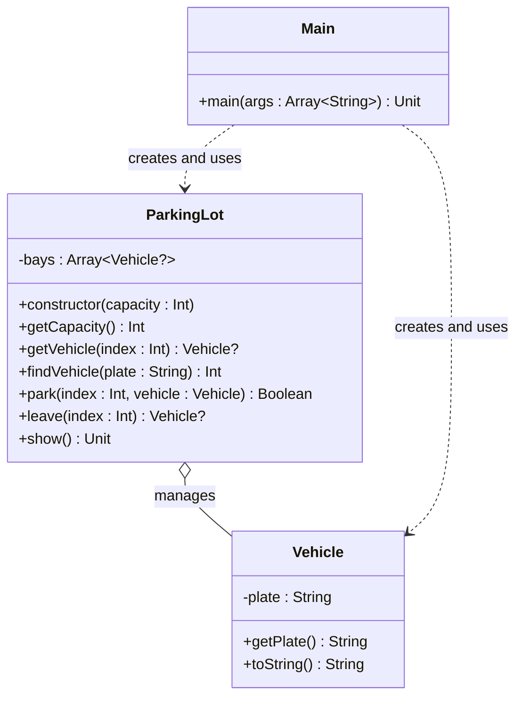

# [TRAIN] Estacionamento Rotativo

<!-- toc-table -->


## Intro

Seu Valdemar administra o *ParkSafe*, um estacionamento no centro financeiro da cidade. O pátio possui um número fixo de vagas demarcadas e numeradas no chão, de `0` até `capacity - 1`. Nos horários de pico, a confusão gerada por carros ocupando vagas já reservadas ou manobristas tentando guardar dois carros na mesma demarcação causava engarrafamentos homéricos na portaria. Para sanar de vez o problema, Valdemar encomendou um sistema digital que gerencie com precisão cirúrgica a ocupação de cada vaga.

Você foi encarregado de construir o núcleo desse sistema em Kotlin, estruturado em três classes: `Vehicle`, `ParkingLot` e `Main`.

### Classes e Métodos

1. **`Vehicle`**:
   - Atributos privados:
     - `plate: String`: a placa ou identificador único do veículo.
   - Métodos:
     - Construtor que recebe `plate`.
     - `getPlate(): String`: retorna a placa do veículo.
     - `toString(): String`: representação textual no formato `[<plate>]`.

2. **`ParkingLot`**:
   - Atributos privados:
     - `bays: Array<Vehicle?>`: vetor de tamanho fixo onde cada índice representa uma vaga numerada. Uma posição com `null` indica que a vaga está vazia.
   - Métodos:
     - Construtor `ParkingLot(capacity: Int)`: inicializa o vetor de vagas com o tamanho informado, todas inicialmente vazias (`null`).
     - `getCapacity(): Int`: retorna o total de vagas.
     - `getVehicle(index: Int): Vehicle?`: retorna o veículo na vaga `index`, ou `null` se vazia/fora do intervalo.
     - `findVehicle(plate: String): Int`: método auxiliar que retorna o índice da vaga onde o veículo com a placa informada se encontra, ou `-1` se não estiver no pátio.
     - `park(index: Int, vehicle: Vehicle): Boolean`: estaciona o veículo na vaga `index`.
       - Falha com `fail: invalid index` se `index < 0` ou `index >= capacity`.
       - Falha com `fail: bay is already occupied` se já houver um veículo na vaga.
       - Falha com `fail: vehicle already parked` se já existir outro veículo com a mesma placa em qualquer vaga do estacionamento.
       - Em caso de sucesso, armazena o veículo e retorna `true`.
     - `leave(index: Int): Vehicle?`: retira o veículo da vaga indicada.
       - Falha com `fail: invalid index` se o índice estiver fora dos limites.
       - Falha com `fail: bay is empty` se a vaga estiver vazia.
       - Em caso de sucesso, desocupa a vaga (atribui `null`) e retorna a referência do veículo removido.
     - `show(): Unit`: imprime o estado de todas as vagas no formato:
       ```text
       0: empty
       1: [CarA]
       2: empty
       ```

3. **`Main`**:
   - Contém a função principal de execução e o laço de interpretação dos comandos do terminal.

## Regras

- A capacidade do pátio é imutável após a inicialização.
- Nenhuma vaga pode ser acessada ou alterada diretamente fora dos métodos da classe `ParkingLot`.
- Vagas desocupadas devem ser estritamente representadas por `null`.
- Não é permitido estacionar dois veículos na mesma vaga simultaneamente.
- Um mesmo veículo (mesma placa) não pode estar estacionado em duas vagas ao mesmo tempo.
- Operações com índices inválidos não devem provocar exceções não tratadas (`IndexOutOfBoundsException`), devendo emitir mensagens amigáveis de erro.

## Diagrama



## Guide

* Comece criando a classe `Vehicle`: ela encapsula apenas uma `String` imutável (`plate`), sem permitir modificações externas após a criação.
* Em `ParkingLot`, declare o atributo de vagas como `private val bays: Array<Vehicle?> = arrayOfNulls(capacity)`. O uso de `Array` de tamanho fixo combinado com o operador de nulidade `?` traduz perfeitamente o conceito de posições fixas com ausência.
* Escreva um método privado de validação de limites `isValidIndex(index: Int): Boolean` para reutilizar nas operações de `park` e `leave`, evitando duplicação de checagens.
* Implemente o método `findVehicle` para percorrer o array e checar se uma placa já existe antes de autorizar a alocação de um novo veículo.
* Na classe `Main`, processe a leitura das linhas com `Scanner` ou `readLine()`, garantindo o eco das entradas que iniciam com `$`.

Perguntas de reflexão:
1. Por que a estrutura `Array<Vehicle?>` é mais adequada para este problema do que uma `ArrayList<Vehicle>` com redimensionamento dinâmico?
2. Como a encapsulação da coleção `bays` garante que a capacidade e a integridade das vagas não sejam burladas pelo código cliente?

## Shell

```bash
#TEST_CASE inicializacao_e_show

$init 3
$show
0: empty
1: empty
2: empty
$end
```

```bash
#TEST_CASE estacionar_com_sucesso

$init 2
$park 0 CarA
$park 1 CarB
$show
0: [CarA]
1: [CarB]
$end
```

```bash
#TEST_CASE falhas_de_estacionar

$init 3
$park -1 CarA
fail: invalid index
$park 3 CarA
fail: invalid index
$park 0 CarA
$park 0 CarB
fail: bay is already occupied
$park 1 CarA
fail: vehicle already parked
$show
0: [CarA]
1: empty
2: empty
$end
```

```bash
#TEST_CASE remocao_veiculo

$init 3
$park 1 CarX
$leave 0
fail: bay is empty
$leave 5
fail: invalid index
$leave 1
$show
0: empty
1: empty
2: empty
$end
```

```bash
#TEST_CASE fluxo_completo_rotativo

$init 2
$park 0 ABC1234
$park 1 XYZ9876
$show
0: [ABC1234]
1: [XYZ9876]
$leave 0
$show
0: empty
1: [XYZ9876]
$park 0 KKK0001
$show
0: [KKK0001]
1: [XYZ9876]
$end
```

<!-- MERMAID -->