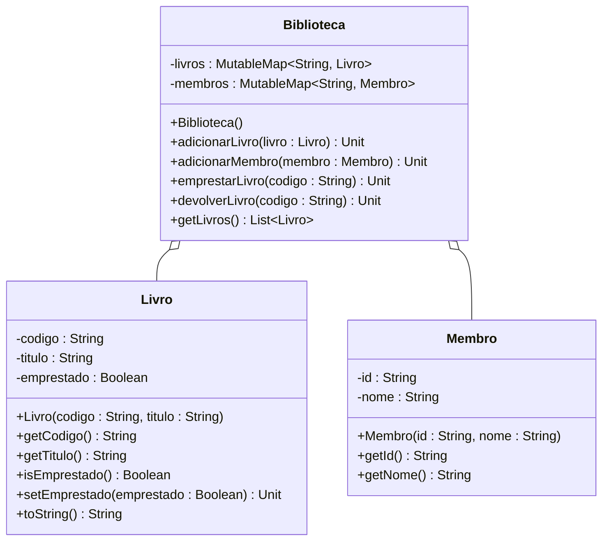

# [TRAIN] Sistema de Gerenciamento de Biblioteca

<!-- toc-table -->


## Intro
Mariana assumiu a gestão da biblioteca comunitária do bairro e rapidamente se deparou com um grande desafio: o controle de empréstimos em fichas de papel vinha causando frequentes conflitos, como a duplicação de códigos no acervo e tentativas de emprestar títulos que já estavam com outros leitores. Para organizar o fluxo diário e garantir a integridade dos dados, Mariana contratou você para desenvolver um sistema seguro e robusto em Kotlin, baseado em coleções indexadas, encapsulamento estrito e sinalização de inconsistências via exceções.

O sistema é estruturado nas seguintes classes e comportamentos:

- **Livro**:
  - Atributos privados: `codigo` (String), `titulo` (String) e `emprestado` (Boolean, inicializado com `false`).
  - Construtor: `Livro(codigo: String, titulo: String)`.
  - Métodos:
    - `getCodigo(): String`: retorna o código identificador do livro.
    - `getTitulo(): String`: retorna o título da obra.
    - `isEmprestado(): Boolean`: indica se o livro está atualmente emprestado.
    - `setEmprestado(emprestado: Boolean): Unit`: altera o estado de empréstimo do livro.
    - `toString(): String`: retorna a representação no formato `codigo:titulo:emprestado`.

- **Membro**:
  - Atributos privados: `id` (String) e `nome` (String).
  - Construtor: `Membro(id: String, nome: String)`.
  - Métodos:
    - `getId(): String`: retorna o identificador do membro.
    - `getNome(): String`: retorna o nome do membro.

- **Biblioteca**:
  - Atributos privados: `livros` (MutableMap<String, Livro>) e `membros` (MutableMap<String, Membro>).
  - Construtor: `Biblioteca()` inicializa os mapas vazios.
  - Métodos:
    - `adicionarLivro(livro: Livro): Unit`: adiciona o livro ao mapa indexado pelo seu código. Lança `IllegalArgumentException` caso já exista um livro com o mesmo código cadastrado.
    - `adicionarMembro(membro: Membro): Unit`: adiciona o membro ao mapa indexado pelo seu id.
    - `emprestarLivro(codigo: String): Unit`: busca o livro pelo código e define seu estado como emprestado (`true`). Lança `NoSuchElementException` se o livro não for encontrado e `IllegalStateException` caso o livro já esteja emprestado.
    - `devolverLivro(codigo: String): Unit`: busca o livro pelo código e define seu estado como disponível (`false`). Lança `NoSuchElementException` se o livro não for encontrado.
    - `getLivros(): List<Livro>`: retorna uma lista com todos os livros presentes no acervo.

Comandos disponíveis no terminal interativo:
- `show`: lista todos os livros cadastrados na biblioteca, um por linha, no formato `codigo:titulo:emprestado`.
- `add_book <codigo> <titulo>`: adiciona um novo livro ao acervo. Se já existir um livro com o código informado, imprime `fail: book already exists`.
- `add_member <id> <nome>`: cadastra um novo membro na biblioteca.
- `lend <codigo>`: realiza o empréstimo do livro com o código informado. Se o livro não existir, imprime `fail: book not found`. Se já estiver emprestado, imprime `fail: book already lent`.
- `return <codigo>`: realiza a devolução do livro com o código informado. Se o livro não for encontrado, imprime `fail: book not found`.
- `end`: encerra o laço de execução do programa.
- Qualquer comando não reconhecido imprime `fail: invalid command`.

## Regras
- Cada livro possui código, título e um indicador booleano de empréstimo que inicia em `false`.
- A representação textual de `Livro` segue estritamente o formato `codigo:titulo:emprestado`.
- Cada membro possui identificador e nome, imutáveis após a criação.
- A biblioteca armazena livros e membros utilizando mapas indexados por suas respectivas chaves identificadoras.
- Tentar adicionar um livro com código já existente lança `IllegalArgumentException`.
- Tentar emprestar um livro inexistente lança `NoSuchElementException`.
- Tentar emprestar um livro que já se encontra emprestado lança `IllegalStateException`.
- Tentar devolver um livro inexistente lança `NoSuchElementException`.
- A devolução bem-sucedida altera o estado de empréstimo do livro para `false`.
- Em caso de exceção capturada durante a execução de comandos, o sistema mantém o estado anterior da biblioteca intacto e imprime a mensagem correspondente.

## Diagrama



## Guide

```kotlin
const val INVALID_COMMAND_MSG: String = "fail: invalid command"
const val BOOK_ALREADY_EXISTS_MSG: String = "fail: book already exists"
const val BOOK_NOT_FOUND_MSG: String = "fail: book not found"
const val BOOK_ALREADY_LENT_MSG: String = "fail: book already lent"

class Livro(private val codigo: String, private val titulo: String) {
    private var emprestado: Boolean = false

    fun getCodigo(): String {
        TODO("implemente getCodigo")
    }

    fun getTitulo(): String {
        TODO("implemente getTitulo")
    }

    fun isEmprestado(): Boolean {
        TODO("implemente isEmprestado")
    }

    fun setEmprestado(emprestado: Boolean): Unit {
        TODO("implemente setEmprestado")
    }

    override fun toString(): String {
        TODO("implemente toString")
    }
}

class Membro(private val id: String, private val nome: String) {
    fun getId(): String {
        TODO("implemente getId")
    }

    fun getNome(): String {
        TODO("implemente getNome")
    }
}

class Biblioteca {
    private val livros: MutableMap<String, Livro> = mutableMapOf()
    private val membros: MutableMap<String, Membro> = mutableMapOf()

    fun adicionarLivro(livro: Livro): Unit {
        TODO("implemente adicionarLivro")
    }

    fun adicionarMembro(membro: Membro): Unit {
        TODO("implemente adicionarMembro")
    }

    fun emprestarLivro(codigo: String): Unit {
        TODO("implemente emprestarLivro")
    }

    fun devolverLivro(codigo: String): Unit {
        TODO("implemente devolverLivro")
    }

    fun getLivros(): List<Livro> {
        TODO("implemente getLivros")
    }
}

fun main(): Unit {
    var biblioteca: Biblioteca = Biblioteca()

    while (true) {
        val line: String = readLine() ?: break
        println("$" + line)

        val parts: List<String> = line.trim().split(Regex("\\s+"))
        when (parts[0]) {
            "end" -> break
            "show" -> {
                for (livro: Livro in biblioteca.getLivros()) { println(livro) }
            }
            "add_book" -> {
                val codigo: String = parts[1]
                val titulo: String = parts[2]
                try { biblioteca.adicionarLivro(Livro(codigo, titulo)) } catch (e: IllegalArgumentException) { println(BOOK_ALREADY_EXISTS_MSG) }
            }
            "add_member" -> {
                val id: String = parts[1]
                val nome: String = parts[2]
                biblioteca.adicionarMembro(Membro(id, nome))
            }
            "lend" -> {
                val codigo: String = parts[1]
                try { biblioteca.emprestarLivro(codigo) } catch (e: NoSuchElementException) { println(BOOK_NOT_FOUND_MSG) } catch (e: IllegalStateException) { println(BOOK_ALREADY_LENT_MSG) }
            }
            "return" -> {
                val codigo: String = parts[1]
                try { biblioteca.devolverLivro(codigo) } catch (e: NoSuchElementException) { println(BOOK_NOT_FOUND_MSG) }
            }
            else -> println(INVALID_COMMAND_MSG)
        }
    }
}
```

## Shell

```bash
#TEST_CASE cadastro_basico

$add_book 101 DomCasmurro
$add_book 102 OAlienísta
$add_member M1 Alice
$show
101:DomCasmurro:false
102:OAlienísta:false
$end
```

```bash
#TEST_CASE emprestimo_e_devolucao

$add_book 101 DomCasmurro
$lend 101
$show
101:DomCasmurro:true
$return 101
$show
101:DomCasmurro:false
$end
```

```bash
#TEST_CASE falhas_livro_inexistente_e_duplicado

$add_book 101 DomCasmurro
$add_book 101 DomCasmurro
fail: book already exists
$lend 999
fail: book not found
$return 999
fail: book not found
$show
101:DomCasmurro:false
$end
```

```bash
#TEST_CASE falha_livro_ja_emprestado

$add_book 101 DomCasmurro
$lend 101
$lend 101
fail: book already lent
$show
101:DomCasmurro:true
$end
```

```bash
#TEST_CASE fluxo_completo_preservacao_estado

$add_member M1 Bob
$add_book 201 1984
$add_book 202 OProcesso
$lend 201
$add_book 201 1984
fail: book already exists
$lend 201
fail: book already lent
$lend 999
fail: book not found
$return 999
fail: book not found
$show
201:1984:true
202:OProcesso:false
$return 201
$show
201:1984:false
202:OProcesso:false
$end
```

<!-- MERMAID -->
