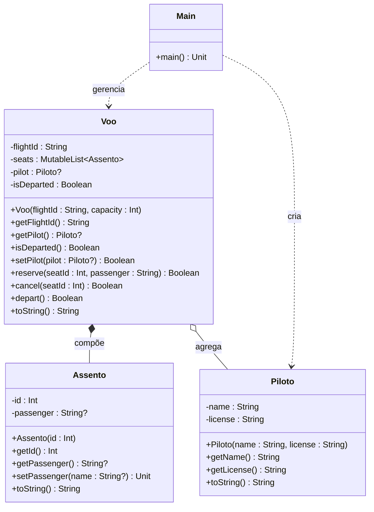

# [TRAIN] Sistema de Controle de Voo Comercial

<!-- toc-table -->


## Intro
A companhia aérea SkyRoutes opera dezenas de voos regionais diariamente e enfrenta desafios constantes na coordenação de embarques e tripulação. Sofia, supervisora de operações de solo, vinha enfrentando problemas recorrentes com reservas duplicadas de poltronas e tentativas de liberação de voo sem a confirmação de um piloto responsável na cabine. Para sanar de vez essas falhas operacionais, a engenharia de software foi acionada para desenvolver um sistema seguro e orientado a objetos para gerenciar o ciclo de cada voo.

O sistema modela a aeronave em operação: cada voo possui sua própria coleção exclusiva de assentos, que são criados no momento em que o voo é cadastrado e destruídos junto com ele (composição forte). Já o piloto da aeronave é um profissional independente, contratado pela companhia, que pode ser designado para assumir o voo a qualquer instante e continuará existindo fora dele (agregação com referência opcional). Antes da decolagem, Sofia e sua equipe realizam reservas de assentos para os passageiros e associam um piloto devidamente habilitado. Se alguém tentar reservar uma poltrona inexistente ou já ocupada, cancelar uma poltrona já vazia, ou ainda autorizar a decolagem de um voo sem piloto, o sistema impede a ação imediatamente.

### Estrutura das Classes

#### Classe `Piloto`
Representa o piloto responsável pela condução do voo.
- **Atributos**:
  - `name: String` (privado): nome do piloto.
  - `license: String` (privado): número de licença do piloto.
- **Construtor**: `Piloto(name: String, license: String)`.
- **Métodos**:
  - `getName(): String`: retorna o nome do piloto.
  - `getLicense(): String`: retorna a licença do piloto.
  - `toString(): String`: retorna a representação no formato `"<name> (<license>)"`.

#### Classe `Assento`
Representa um assento exclusivo pertencente ao voo.
- **Atributos**:
  - `id: Int` (privado): identificador numérico do assento.
  - `passenger: String?` (privado): nome do passageiro alocado, ou `null` se estiver livre (inicializado como `null`).
- **Construtor**: `Assento(id: Int)`.
- **Métodos**:
  - `getId(): Int`: retorna o identificador do assento.
  - `getPassenger(): String?`: retorna o nome do passageiro ou `null`.
  - `setPassenger(name: String?): Unit`: define o passageiro do assento.
  - `toString(): String`: retorna no formato `"Seat <id>: <passenger>"` ou `"Seat <id>: empty"` se estiver livre.

#### Classe `Voo`
Representa o voo comercial que controla a coleção de assentos e o piloto associado.
- **Atributos**:
  - `flightId: String` (privado): identificador do voo.
  - `seats: MutableList<Assento>` (privado): lista mutável de assentos criados no voo.
  - `pilot: Piloto?` (privado): referência opcional para o piloto atribuído ao voo (inicializado como `null`).
  - `isDeparted: Boolean` (privado): indica se o voo já decolou (inicializado como `false`).
- **Construtor**: `Voo(flightId: String, capacity: Int)`. No bloco de inicialização, cria e adiciona à lista `seats` os assentos com IDs de `0` até `capacity - 1`.
- **Métodos**:
  - `getFlightId(): String`: retorna o identificador do voo.
  - `getPilot(): Piloto?`: retorna o piloto associado, ou `null`.
  - `isDeparted(): Boolean`: retorna se o voo já decolou.
  - `setPilot(pilot: Piloto?): Boolean`: define o piloto do voo e retorna `true`.
  - `reserve(seatId: Int, passenger: String): Boolean`: busca o assento pelo `seatId`. Retorna `false` se o assento não existir ou se já possuir passageiro; caso contrário, define o passageiro e retorna `true`.
  - `cancel(seatId: Int): Boolean`: busca o assento pelo `seatId`. Retorna `false` se o assento não existir ou se não tiver passageiro; caso contrário, remove o passageiro atribuindo `null` e retorna `true`.
  - `depart(): Boolean`: verifica se há piloto associado (`pilot != null`) e se ainda não decolou (`!isDeparted`). Caso contrário, retorna `false`. Em sucesso, define `isDeparted = true` e retorna `true`.
  - `toString(): String`: retorna o resumo do voo com cabeçalho `"Flight: <flightId> | Pilot: <pilot ou none> | Status: <departed ou on-ground>"` seguido por uma linha para cada assento no formato `"\n- <assento>"`.

### Comandos do Programa
- `init <flightId> <capacity>`: cria o voo com o ID e a capacidade informados. Se o voo já estiver criado (`flightId` não vazio), imprime `fail: flight already exists`.
- `show`: exibe a representação textual do voo e seus assentos.
- `set_pilot <name> <license>`: instancia um `Piloto` e o associa ao voo atual.
- `reserve <seatId> <passenger>`: reserva o assento para o passageiro indicado. Em caso de falha, imprime `fail: seat unavailable`.
- `cancel <seatId>`: cancela a reserva do assento indicado. Em caso de falha, imprime `fail: seat empty or invalid`.
- `depart`: realiza a decolagem do voo. Em caso de falha, imprime `fail: flight cannot depart without pilot`.
- `end`: encerra a execução do programa.
- Qualquer outro comando imprime `fail: invalid command`.

## Regras
- Um voo só pode ser inicializado via comando `init` se ainda não houver um voo ativo (`flightId` vazio). Caso contrário, a criação é recusada.
- Os assentos são criados com IDs sequenciais de 0 até `capacity - 1` na inicialização do voo e têm ciclo de vida dependente do voo (composição).
- O piloto é um objeto independente que pode ser associado ou desassociado do voo (agregação).
- Uma reserva só é efetuada se o assento com o ID informado existir no voo e não estiver ocupado.
- Um cancelamento de assento só é efetuado se o assento com o ID informado existir no voo e estiver ocupado.
- A decolagem só ocorre se o voo possuir um piloto atribuído e ainda não tiver decolado.
- As classes de domínio retornam valores booleanos indicando o sucesso ou a falha de cada operação, cabendo à camada de controle imprimir as respectivas mensagens de erro.

## Diagrama



## Guide

```kotlin
const val INVALID_COMMAND_MSG: String = "fail: invalid command"
const val FLIGHT_ALREADY_EXISTS_MSG: String = "fail: flight already exists"
const val SEAT_UNAVAILABLE_MSG: String = "fail: seat unavailable"
const val SEAT_EMPTY_OR_INVALID_MSG: String = "fail: seat empty or invalid"
const val NO_PILOT_MSG: String = "fail: flight cannot depart without pilot"

class Piloto(private val name: String, private val license: String) {
    fun getName(): String {
        TODO("implemente getName")
    }
    fun getLicense(): String {
        TODO("implemente getLicense")
    }

    override fun toString(): String {
        TODO("implemente toString")
    }
}

class Assento(private val id: Int) {
    private var passenger: String? = null

    fun getId(): Int {
        TODO("implemente getId")
    }
    fun getPassenger(): String? {
        TODO("implemente getPassenger")
    }

    fun setPassenger(name: String?): Unit {
        TODO("implemente setPassenger")
    }

    override fun toString(): String {
        TODO("implemente toString")
    }
}

class Voo(private val flightId: String, capacity: Int) {
    private val seats: MutableList<Assento> = mutableListOf()
    private var pilot: Piloto? = null
    private var isDeparted: Boolean = false

    init {
        // TODO: inicialize os atributos
    }

    fun getFlightId(): String {
        TODO("implemente getFlightId")
    }
    fun getPilot(): Piloto? {
        TODO("implemente getPilot")
    }
    fun isDeparted(): Boolean {
        TODO("implemente isDeparted")
    }

    fun setPilot(pilot: Piloto?): Boolean {
        TODO("implemente setPilot")
    }

    fun reserve(seatId: Int, passenger: String): Boolean {
        TODO("implemente reserve")
    }

    fun cancel(seatId: Int): Boolean {
        TODO("implemente cancel")
    }

    fun depart(): Boolean {
        TODO("implemente depart")
    }

    override fun toString(): String {
        TODO("implemente toString")
    }
}

fun main(): Unit {
    var flight: Voo = Voo("", 0)

    while (true) {
        val line: String = readLine() ?: break
        println("$" + line)

        val parts: List<String> = line.trim().split(Regex("\\s+"))
        when (parts[0]) {
            "end" -> break
            "init" -> {
                val flightId: String = parts[1]
                val capacity: Int = parts[2].toInt()
                if (flight.getFlightId().isNotEmpty()) { println(FLIGHT_ALREADY_EXISTS_MSG) } else { flight = Voo(flightId, capacity) }
            }
            "show" -> {
                println(flight)
            }
            "set_pilot" -> {
                val name: String = parts[1]
                val license: String = parts[2]
                flight.setPilot(Piloto(name, license))
            }
            "reserve" -> {
                val seatId: Int = parts[1].toInt()
                val passenger: String = parts[2]
                if (!flight.reserve(seatId, passenger)) { println(SEAT_UNAVAILABLE_MSG) }
            }
            "cancel" -> {
                val seatId: Int = parts[1].toInt()
                if (!flight.cancel(seatId)) { println(SEAT_EMPTY_OR_INVALID_MSG) }
            }
            "depart" -> {
                if (!flight.depart()) { println(NO_PILOT_MSG) }
            }
            else -> println(INVALID_COMMAND_MSG)
        }
    }
}
```

## Shell

```bash
#TEST_CASE fluxo_basico

$init G3-1500 2
$show
Flight: G3-1500 | Pilot: none | Status: on-ground
- Seat 0: empty
- Seat 1: empty
$set_pilot Carlos BR-1234
$reserve 0 Alice
$show
Flight: G3-1500 | Pilot: Carlos (BR-1234) | Status: on-ground
- Seat 0: Alice
- Seat 1: empty
$depart
$show
Flight: G3-1500 | Pilot: Carlos (BR-1234) | Status: departed
- Seat 0: Alice
- Seat 1: empty
$end
```

```bash
#TEST_CASE falhas_reserva_cancelamento

$init LA-3020 2
$reserve 0 Bob
$reserve 0 Charlie
fail: seat unavailable
$reserve 5 Daniel
fail: seat unavailable
$cancel 1
fail: seat empty or invalid
$cancel 9
fail: seat empty or invalid
$cancel 0
$show
Flight: LA-3020 | Pilot: none | Status: on-ground
- Seat 0: empty
- Seat 1: empty
$end
```

```bash
#TEST_CASE decolagem_sem_piloto

$init AD-4001 2
$depart
fail: flight cannot depart without pilot
$set_pilot Marcos BR-9988
$depart
$depart
fail: flight cannot depart without pilot
$show
Flight: AD-4001 | Pilot: Marcos (BR-9988) | Status: departed
- Seat 0: empty
- Seat 1: empty
$end
```

```bash
#TEST_CASE fronteira_e_duplicacao

$init TP-01 3
$init TP-02 4
fail: flight already exists
$reserve -1 Passageiro
fail: seat unavailable
$reserve 0 PassageiroZero
$reserve 2 PassageiroDois
$reserve 3 PassageiroTres
fail: seat unavailable
$show
Flight: TP-01 | Pilot: none | Status: on-ground
- Seat 0: PassageiroZero
- Seat 1: empty
- Seat 2: PassageiroDois
$end
```

```bash
#TEST_CASE ciclo_completo

$init AF-447 3
$set_pilot Pierre FR-5521
$reserve 0 Jean
$reserve 1 Marie
$reserve 2 Paul
$show
Flight: AF-447 | Pilot: Pierre (FR-5521) | Status: on-ground
- Seat 0: Jean
- Seat 1: Marie
- Seat 2: Paul
$cancel 1
$reserve 1 Claire
$show
Flight: AF-447 | Pilot: Pierre (FR-5521) | Status: on-ground
- Seat 0: Jean
- Seat 1: Claire
- Seat 2: Paul
$depart
$show
Flight: AF-447 | Pilot: Pierre (FR-5521) | Status: departed
- Seat 0: Jean
- Seat 1: Claire
- Seat 2: Paul
$end
```

<!-- MERMAID -->
