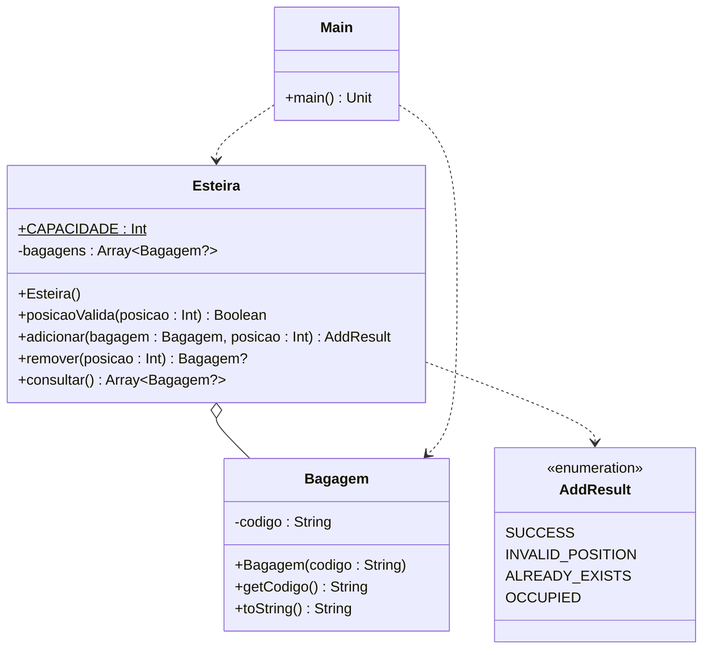

# [TRAIN] Esteira de Bagagem

<!-- toc-table -->


## Intro

No Aeroporto Internacional, o engenheiro de automação Carlos foi chamado para resolver um problema crítico no terminal de desembarque. O carrossel de bagagens conta com uma esteira mecânica dividida em exatamente 6 nichos físicos fixos, indexados de 0 a 5. O sistema legado vinha apresentando falhas graves: malas eram registradas em compartimentos inexistentes, passageiros tentavam colocar malas em nichos já ocupados causando colisões nos sensores, e bagagens idênticas eram inseridas simultaneamente em posições diferentes.

Para sanar o caos logístico, você deve construir o novo módulo de software orientado a objetos responsável por gerenciar a esteira e suas bagagens, tratando com rigor o conceito de posições fixas e ausência (`null`).

### Classes e Estrutura

- **`Bagagem`**:
  - Atributo privado: `codigo: String`.
  - Construtor: recebe `codigo`.
  - Métodos:
    - `getCodigo(): String`: retorna o identificador da mala.
    - `toString(): String`: retorna o próprio código.

- **`AddResult`** (enum):
  - Constantes para expressar o resultado da inserção:
    - `SUCCESS`: inserção realizada com sucesso.
    - `INVALID_POSITION`: o índice informado está fora dos limites da esteira.
    - `ALREADY_EXISTS`: já existe uma bagagem com o mesmo código na esteira.
    - `OCCUPIED`: a posição indicada já está ocupada por outra mala.

- **`Esteira`**:
  - Constante estática: `CAPACIDADE: Int = 6`.
  - Atributo privado: `bagagens: Array<Bagagem?>` inicializado com 6 posições nulas.
  - Métodos:
    - `posicaoValida(posicao: Int): Boolean`: verifica se o índice está entre 0 e 5 (inclusive).
    - `adicionar(bagagem: Bagagem, posicao: Int): AddResult`: valida as regras de negócio e insere a mala caso tudo esteja correto. A validação de posição inexistente tem precedência, seguida pela duplicidade do código e pela ocupação da vaga.
    - `remover(posicao: Int): Bagagem?`: se a posição for válida e estiver ocupada, desocupa o nicho (atribuindo `null`) e retorna a bagagem removida; caso a posição seja inválida ou esteja vazia, retorna `null`.
    - `consultar(): Array<Bagagem?>`: retorna uma cópia rasa (*shallow copy*) do array de bagagens, impedindo que chamadores externos alterem diretamente a estrutura interna da esteira.

### Comandos da Interface (`Main`)

- `$show`: Imprime o estado da esteira no formato `[elem0, elem1, elem2, elem3, elem4, elem5]`, onde cada nicho ocupado mostra o código da bagagem e nichos vazios mostram `empty`.
- `$add codigo posicao`: Tenta adicionar a bagagem na posição informada. Em caso de falha, imprime:
  - `fail: invalid position`
  - `fail: duplicate baggage`
  - `fail: position occupied`
- `$remove posicao`: Tenta remover a bagagem da posição informada. Em caso de falha, imprime:
  - `fail: invalid position` (quando a posição não for válida)
  - `fail: empty position` (quando a posição for válida, mas estiver desocupada)
- `$end`: Finaliza a execução do programa.

## Regras

- A esteira possui capacidade física fixa de 6 posições (índices válidos de 0 a 5).
- Cada posição armazena exatamente uma referência a `Bagagem` ou `null` quando vazia.
- Posições menores que 0 ou maiores ou iguais a 6 são consideradas inválidas.
- Não é permitido adicionar uma bagagem em uma posição que já esteja ocupada.
- Não é permitido adicionar uma bagagem cujo código identificador já exista em qualquer posição da esteira.
- A consulta (`consultar()`) deve retornar uma cópia do array interno para preservar o encapsulamento.
- A remoção em uma posição vazia ou inválida não altera o estado da esteira.
- As classes de domínio (`Bagagem`, `Esteira`) nunca realizam operações de entrada e saída (E/S); todas as mensagens em inglês são emitidas exclusivamente pela `Main`.

## Diagrama



## Guide

```kotlin
const val INVALID_COMMAND_MSG: String = "fail: invalid command"
const val INVALID_POSITION_MSG: String = "fail: invalid position"
const val DUPLICATE_BAGGAGE_MSG: String = "fail: duplicate baggage"
const val POSITION_OCCUPIED_MSG: String = "fail: position occupied"
const val EMPTY_POSITION_MSG: String = "fail: empty position"

enum class AddResult {
    SUCCESS,
    INVALID_POSITION,
    ALREADY_EXISTS,
    OCCUPIED
}

class Bagagem(private val codigo: String = "") {
    fun getCodigo(): String {
        TODO("retorne o código identificador da bagagem")
    }

    override fun toString(): String {
        TODO("retorne o código identificador da bagagem")
    }
}

class Esteira {
    companion object {
        const val CAPACIDADE: Int = 6
    }

    private var bagagens: Array<Bagagem?> = arrayOfNulls<Bagagem>(CAPACIDADE)

    fun posicaoValida(posicao: Int): Boolean {
        TODO("verifique se a posição informada é válida")
    }

    fun adicionar(bagagem: Bagagem, posicao: Int): AddResult {
        TODO("adicione a bagagem na esteira conforme as regras de negócio")
    }

    fun remover(posicao: Int): Bagagem? {
        TODO("remova e retorne a bagagem da posição informada, ou null se não houver")
    }

    fun consultar(): Array<Bagagem?> {
        TODO("retorne uma cópia do array de bagagens")
    }

    override fun toString(): String {
        TODO("retorne a representação textual da esteira")
    }
}

fun main(): Unit {
    val esteira: Esteira = Esteira()

    while (true) {
        val line: String = readLine() ?: break
        println("$" + line)

        val parts: List<String> = line.trim().split(Regex("\\s+"))
        when (parts[0]) {
            "end" -> break
            "show" -> println(esteira)
            "add" -> when (esteira.adicionar(Bagagem(parts[1]), parts[2].toInt())) {
                AddResult.INVALID_POSITION -> println(INVALID_POSITION_MSG)
                AddResult.ALREADY_EXISTS -> println(DUPLICATE_BAGGAGE_MSG)
                AddResult.OCCUPIED -> println(POSITION_OCCUPIED_MSG)
                AddResult.SUCCESS -> {}
            }
            "remove" -> {
                val posicao: Int = parts[1].toInt()
                if (!esteira.posicaoValida(posicao)) {
                    println(INVALID_POSITION_MSG)
                } else if (esteira.remover(posicao) == null) {
                    println(EMPTY_POSITION_MSG)
                }
            }
            else -> println(INVALID_COMMAND_MSG)
        }
    }
}
```

## Shell

```bash
#TEST_CASE iniciando

$show
[empty, empty, empty, empty, empty, empty]
$add A100 0
$add B200 2
$show
[A100, empty, B200, empty, empty, empty]
$end
```

```bash
#TEST_CASE conflitos_e_limites

$add C300 6
fail: invalid position
$add C300 -1
fail: invalid position
$add A100 3
$add A100 5
fail: duplicate baggage
$add B200 3
fail: position occupied
$show
[empty, empty, empty, A100, empty, empty]
$end
```

```bash
#TEST_CASE remocao_e_reocupacao

$add M50 1
$show
[empty, M50, empty, empty, empty, empty]
$remove 1
$show
[empty, empty, empty, empty, empty, empty]
$remove 1
fail: empty position
$add M50 1
$show
[empty, M50, empty, empty, empty, empty]
$end
```

```bash
#TEST_CASE remocao_invalida

$remove -1
fail: invalid position
$remove 6
fail: invalid position
$remove 10
fail: invalid position
$end
```

```bash
#TEST_CASE preenchimento_e_preservacao

$add X0 0
$add X1 1
$add X2 2
$add X3 3
$add X4 4
$add X5 5
$show
[X0, X1, X2, X3, X4, X5]
$add X6 0
fail: position occupied
$add X0 2
fail: duplicate baggage
$remove 3
$show
[X0, X1, X2, empty, X4, X5]
$add X99 3
$show
[X0, X1, X2, X99, X4, X5]
$end
```

<!-- MERMAID -->