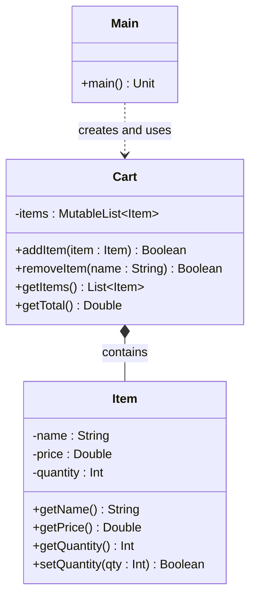

# [TRAIN] Carrinho de Compras da Padaria Artesanal

<!-- toc-table -->


## Intro

Margarida é a confeiteira chefe da "A Fofoca do Trigo", uma padaria artesanal famosa por seus pães de fermentação natural e bolos recheados. Para modernizar o atendimento e evitar erros manuais no balcão, Margarida encomendou um sistema digital de carrinho de compras. O software precisa ser robusto o suficiente para garantir que os clientes não comprem quantidades absurdas de um único produto em uma única tacada (como 50 baguetes de uma vez, respeitando o limite máximo de 10 unidades por item) e calcular com precisão cirúrgica o valor total da comanda.

Nesta atividade, você desenvolverá duas classes principais: `Item` e `Cart`. A classe `Item` será responsável por encapsular os dados do produto (nome, preço e quantidade) e proteger suas invariantes através de validações rígidas. A classe `Cart` utilizará uma coleção linear privada (`MutableList<Item>`) para gerenciar os produtos adicionados, garantindo que não haja duplicidade de nomes e que o valor total seja calculado corretamente. O programa interage via linha de comando (Shell), interpretando comandos como `add`, `remove`, `show` e `end`.

## Regras

- A classe `Item` armazena o nome do produto (`String`), o preço unitário (`Double`) e a quantidade (`Int`).
- A quantidade de um `Item` possui uma invariante: deve estar estritamente entre 1 e a quantidade máxima permitida (fixada em 10 unidades). O método de alteração deve retornar `false` se o valor for inválido.
- A classe `Cart` mantém uma coleção linear privada (`MutableList<Item>`) contendo os itens do carrinho.
- O método `addItem(item: Item): Boolean` adiciona um item ao carrinho, retornando `false` caso já exista um item com o mesmo nome ou se os dados forem inválidos.
- O método `removeItem(name: String): Boolean` remove um item da coleção pelo nome, retornando `false` se o item não for encontrado.
- O método `getTotal(): Double` calcula e retorna o valor total da compra somando o subtotal (`preço × quantidade`) de cada item.
- As classes de domínio nunca imprimem nada na tela; toda saída e tratamento de falhas com o prefixo `fail:` deve ser feita exclusivamente na camada de apresentação (`main`).

## Diagrama


## Guide

* **Passo 1 — Implementar a classe `Item`:** Crie os atributos privados e o construtor. Implemente o método `setQuantity(qty: Int): Boolean` aplicando a regra de invariante (entre 1 e 10 inclusive).
* **Passo 2 — Implementar a classe `Cart`:** Declare a lista mutável privada `MutableList<Item>`. Crie o método de busca interna por nome para evitar duplicidade.
* **Passo 3 — Adição e Remoção no `Cart`:** Implemente `addItem` validando duplicatas e limites, e `removeItem` buscando e removendo o elemento correspondente.
* **Passo 4 — Cálculo do Total e Shell:** Implemente o método `getTotal()` somando os subtotais e, por fim, construa a função `main` para processar os comandos do Shell, ecoando cada entrada e formatando as falhas com `fail:`.

Perguntas de reflexão: 
- Por que a lista de itens dentro de `Cart` deve ser privada e exposta apenas por métodos de modificação controlada? 
- Como o encapsulamento da quantidade na classe `Item` protege a integridade do cálculo do valor total realizado pelo carrinho?

## Shell

```bash
#TEST_CASE AdicaoValida
$init
$add pao 0.50 5
$add bolo 20.00 1
$show
pao: 5 x 0.50
bolo: 1 x 20.00
total: 22.50
$end
```

```bash
#TEST_CASE QuantidadeInvalida
$init
$add pao 0.50 15
fail: invalid quantity
$show
total: 0.00
$end
```

```bash
#TEST_CASE ItemDuplicado
$init
$add pao 0.50 2
$add pao 0.60 3
fail: existing item
$show
pao: 2 x 0.50
total: 1.00
$end
```

```bash
#TEST_CASE RemocaoSucesso
$init
$add pao 0.50 4
$add leite 4.00 2
$remove pao
$show
leite: 2 x 4.00
total: 8.00
$end
```

```bash
#TEST_CASE RemocaoFalha
$init
$remove cafe
fail: item not found
$end
```

<!-- MERMAID -->