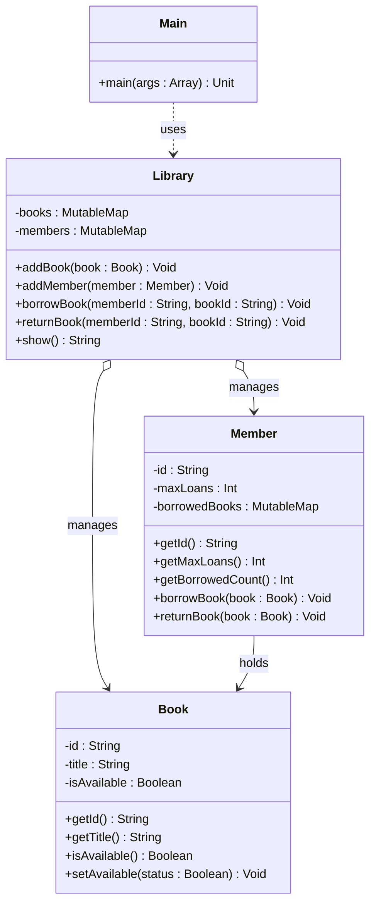

# [TRAIN] Biblioteca de Bairro

<!-- toc-table -->


## Intro

Seu Joaquim, o bibliotecário da charmosa "Biblioteca Comunitária do Bairro", está enfrentando problemas com o caderno de controle de empréstimos. Livros sumiram, sócios pegam mais exemplares do que o permitido e confusões com devoluções são constantes. Para salvar o acervo, você foi contratado para desenvolver um sistema moderno em Kotlin orientado a objetos.

O sistema é composto por três classes principais:
1. **`Book`**: Representa um livro no acervo com os atributos privados `id` (String), `title` (String) e `isAvailable` (Boolean). Oferece métodos para consultar os dados e alterar a disponibilidade de forma segura.
2. **`Member`**: Representa um sócio da biblioteca com identificador `id` (String) e `maxLoans` (Int). Mantém uma lista ou mapa interno com os livros atualmente emprestados, garantindo que o limite máximo de empréstimos nunca seja violado.
3. **`Library`**: O núcleo do sistema. Utiliza mapas (`Map`) para indexar livros e sócios por seus respectivos IDs. Gerencia operações de cadastro, empréstimo e devolução, aplicando validações rigorosas e lançando exceções (`IllegalArgumentException` ou `IllegalStateException`) quando regras de negócio são violadas.

## Regras

- O acervo de livros e o cadastro de sócios são indexados por seus respectivos IDs usando mapas.
- Um livro só pode ser emprestado se estiver disponível (`isAvailable == true`).
- Um sócio não pode exceder o seu limite de empréstimos simultâneos (`maxLoans`).
- Tentativas de emprestar um livro já emprestado, de um sócio inexistente, de um livro inexistente, ou exceder o limite de empréstimos devem lançar exceções com mensagens padronizadas em inglês iniciadas por `fail:`.
- As classes de domínio **nunca** imprimem nada; elas retornam valores ou lançam exceções. Apenas a classe principal (`main`/Shell) lê a entrada, interage com o domínio e imprime os resultados ou as falhas capturadas.

## Diagrama



## Guide

* **Passo 1 (`Book`)**: Implemente a classe `Book` com atributos privados, getters e um método encapsulado para alterar a disponibilidade (`setAvailable`). Garanta que o estado inicial do livro seja sempre disponível (`true`).
* **Passo 2 (`Member`)**: Crie a classe `Member` armazenando o ID, o limite de empréstimos e uma coleção interna (`MutableMap` ou `MutableList`) para os livros emprestados. Adicione métodos para registrar o empréstimo e a devolução de um livro, lançando exceções se o limite for atingido.
* **Passo 3 (`Library`)**: Desenvolva a classe `Library` utilizando `MutableMap<String, Book>` e `MutableMap<String, Member>`. Implemente as verificações de existência (lançando exceções se um ID já existir ao cadastrar ou se não existir ao operar) e coordene as transações de empréstimo e devolução entre `Book` e `Member`.
* **Passo 4 (`Shell / Main`)**: Construa o interpretador de comandos no `main`. Utilize blocos `try-catch` para capturar exceções lançadas pelas classes de domínio e imprima as mensagens de erro prefixadas com `fail:` exatamente como especificado.

Perguntas de reflexão:
1. Como o uso de mapas (`Map<String, Book>` e `Map<String, Member>`) na classe `Library` otimiza a busca por IDs em comparação ao uso de listas lineares?
2. De que maneira o lançamento de exceções nas classes de domínio (em vez de retornar booleanos ou imprimir mensagens diretamente) protege as invariantes do sistema contra estados inconsistentes?

## Shell

```bash
#TEST_CASE CadastroBasico
$init
$addBook b1 Dom_Casmurro
$addMember m1 2
$show
book: b1 : Dom_Casmurro : available
member: m1 : loans: 0 / max: 2
$end
```

```bash
#TEST_CASE EmprestimoBemSucedido
$init
$addBook b1 O_Guarani
$addMember m1 1
$borrow m1 b1
$show
book: b1 : O_Guarani : unavailable
member: m1 : loans: 1 / max: 1
$end
```

```bash
#TEST_CASE FalhaLivroIndisponivel
$init
$addBook b1 Capitaes_da_Areia
$addMember m1 2
$addMember m2 2
$borrow m1 b1
$borrow m2 b1
fail: book is not available
$end
```

```bash
#TEST_CASE FalhaLimiteExcedido
$init
$addBook b1 Livro_A
$addBook b2 Livro_B
$addMember m1 1
$borrow m1 b1
$borrow m1 b2
fail: member reached loan limit
$end
```

```bash
#TEST_CASE DevolucaoNovoEmprestimo
$init
$addBook b1 Memorias_Postumas
$addMember m1 1
$borrow m1 b1
$return m1 b1
$borrow m1 b1
$show
book: b1 : Memorias_Postumas : unavailable
member: m1 : loans: 1 / max: 1
$end

```
