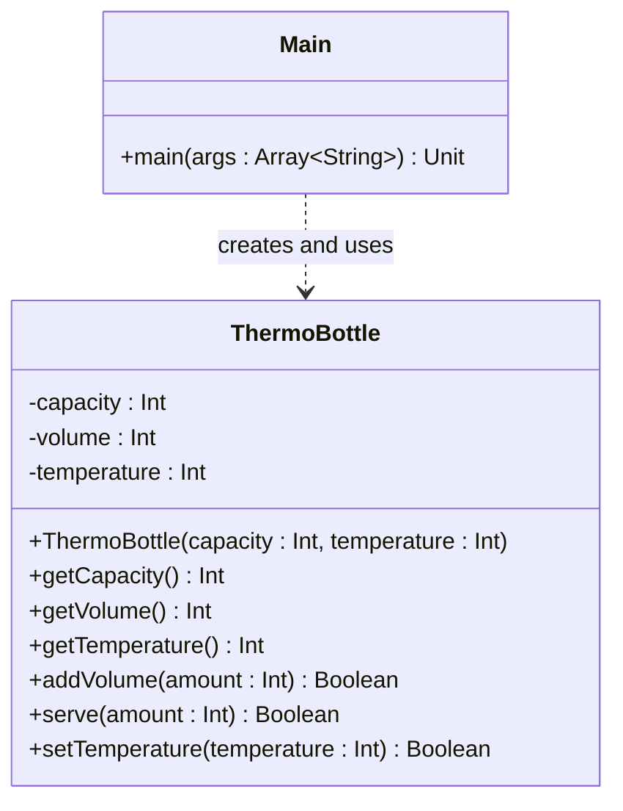

# [TRAIN] Garrafa Térmica Inteligente

<!-- toc-table -->


## Intro

Marina é engenheira de firmware na *ThermoIoT*, uma startup especializada em utensílios conectados para atletas de alta performance e montanhistas. Sua equipe foi encarregada de projetar o software do modelo *HydraSmart 3000*, uma garrafa térmica com display digital, sensores de nível de fluido e regulagem de temperatura.

Durante os primeiros testes em laboratório, uma falha crítica de lógica de software provocou o transbordamento de água fervente sobre a placa eletrônica, danificando os sensores. Além disso, quando a garrafa tentava bombear líquido inexistente, o módulo de aquecimento operava a seco, reduzindo drasticamente a vida útil do aparelho.

Para evitar novos acidentes, Marina decidiu desacoplar a interface de controle do núcleo de regras físicas. Seu objetivo é desenvolver a classe `ThermoBottle`, protegendo as invariantes do dispositivo por meio de encapsulamento: capacidade total, volume atual e temperatura devem ser blindados contra modificações diretas e incoerentes. Qualquer tentativa de abastecer além do limite, servir mais água do que o reservatório contém ou fixar temperaturas perigosas deve ser recusada sem alterar o estado prévio da garrafa.

### Estrutura da Classe

- **Atributos Privados:**
  - `capacity: Int`: capacidade volumétrica máxima da garrafa (em ml).
  - `volume: Int`: volume atual de líquido (em ml), inicializado em 0.
  - `temperature: Int`: temperatura interna atual do líquido (em graus Celsius).

- **Construtor:**
  - `ThermoBottle(capacity: Int, temperature: Int)`: inicializa a capacidade máxima e a temperatura inicial da garrafa. O volume inicial deve ser sempre `0`.

- **Métodos Públicos:**
  - `getCapacity(): Int`: retorna a capacidade máxima.
  - `getVolume(): Int`: retorna o volume atual.
  - `getTemperature(): Int`: retorna a temperatura atual.
  - `addVolume(amount: Int): Boolean`: abastece a garrafa com a quantidade informada. Retorna `false` se `amount <= 0` ou se a adição fizer o volume ultrapassar a capacidade máxima; caso contrário, incrementa o volume e retorna `true`.
  - `serve(amount: Int): Boolean`: retira líquido da garrafa. Retorna `false` se `amount <= 0` ou se `amount` for maior que o volume disponível; caso contrário, subtrai do volume e retorna `true`.
  - `setTemperature(temperature: Int): Boolean`: ajusta a temperatura da garrafa. Retorna `false` se o valor estiver fora da faixa operacional segura (entre 0 e 100 °C, inclusive); caso contrário, atualiza a temperatura e retorna `true`.

### Comandos da Interface

- `$init <capacity> <temperature>`: instancia uma nova garrafa térmica com a capacidade e a temperatura especificadas.
- `$show`: exibe o estado atual da garrafa no formato: `capacity: {capacity}, volume: {volume}, temperature: {temperature}`.
- `$add <amount>`: tenta adicionar líquido; imprime `fail: overflow` caso a operação retorne `false`.
- `$serve <amount>`: tenta retirar líquido; imprime `fail: not enough water` caso a operação retorne `false`.
- `$temp <temperature>`: tenta alterar a temperatura; imprime `fail: invalid temperature` caso a operação retorne `false`.
- `$end`: encerra a execução do programa.

## Regras

- A capacidade máxima deve ser um valor estritamente positivo e não pode ser modificada após a criação do objeto.
- O volume nunca pode ser negativo nem ultrapassar a capacidade da garrafa.
- Se uma operação de abastecimento falhar por excesso ou valor inválido, o volume prévio deve ser estritamente preservado.
- Se uma operação de servir falhar por falta de líquido ou valor inválido, o volume prévio deve ser estritamente preservado.
- A faixa permitida de temperatura é de 0 a 100 graus Celsius (inclusivos). Valores fora desse intervalo são recusados.
- A classe `ThermoBottle` não deve realizar nenhuma leitura de console nem impressão com `println`; ela deve apenas validar regras e retornar valores booleanos.
- Toda impressão de mensagens de erro (`fail: ...`) e formatação de saída ocorre exclusivamente na classe `Main`.

## Diagrama



## Guide

* Passo 1: Crie a classe `ThermoBottle` declarando as propriedades `capacity`, `volume` e `temperature` como privadas (`private var` ou `private val`), garantindo que `volume` sempre inicie em 0 e fornecendo métodos de leitura (getters) públicos.
* Passo 2: Implemente o método `setTemperature(temperature: Int): Boolean`. Valide se o valor recebido está dentro do intervalo `0..100`. Atualize o atributo apenas em caso afirmativo e retorne o status da alteração.
* Passo 3: Implemente os métodos `addVolume(amount: Int): Boolean` e `serve(amount: Int): Boolean`. Certifique-se de rejeitar quantias negativas ou nulas (`amount <= 0`) e verifique se a operação ultrapassa os limites mínimo (`0`) e máximo (`capacity`).
* Passo 4: Implemente a classe `Main` com o laço de leitura de comandos. Faça o eco de cada comando digitado prefixado com `$` e trate os retornos booleanos dos métodos para disparar as mensagens de erro especificadas.

Perguntas de reflexão:
- Por que é vantajoso que o método `addVolume` recuse a operação por completo em vez de encher a garrafa parcialmente até a borda?
- De que forma manter `volume` privado impede que partes externas do sistema quebrem a invariante de capacidade máxima?

## Shell

```bash
#TEST_CASE inicializacao_e_consulta

$init 1000 25
$show
capacity: 1000, volume: 0, temperature: 25
$end
```

```bash
#TEST_CASE abastecimento_e_transbordamento

$init 500 20
$add 300
$show
capacity: 500, volume: 300, temperature: 20
$add 300
fail: overflow
$show
capacity: 500, volume: 300, temperature: 20
$end
```

```bash
#TEST_CASE servindo_liquido_e_limites

$init 1000 60
$add 400
$serve 150
$show
capacity: 1000, volume: 250, temperature: 60
$serve 300
fail: not enough water
$show
capacity: 1000, volume: 250, temperature: 60
$end
```

```bash
#TEST_CASE controle_de_temperatura

$init 800 50
$temp 85
$show
capacity: 800, volume: 0, temperature: 85
$temp 150
fail: invalid temperature
$temp -5
fail: invalid temperature
$show
capacity: 800, volume: 0, temperature: 85
$end
```

```bash
#TEST_CASE sequencia_de_operacoes

$init 600 10
$add 600
$serve 600
$add 100
$temp 45
$show
capacity: 600, volume: 100, temperature: 45
$end
```

```bash
#TEST_CASE valores_fronteira_e_negativos

$init 750 20
$add 0
fail: overflow
$add -50
fail: overflow
$serve 0
fail: not enough water
$serve -10
fail: not enough water
$temp 0
$temp 100
$show
capacity: 750, volume: 0, temperature: 100
$end

```
