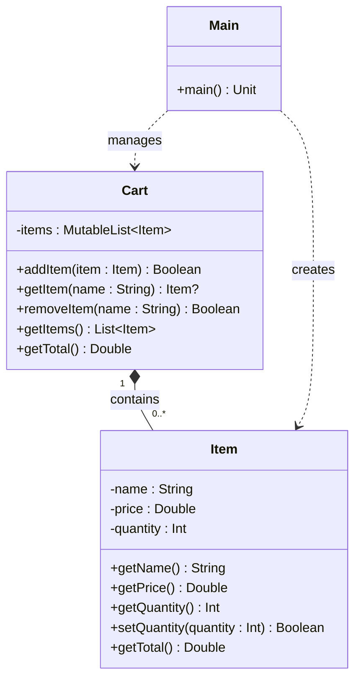

# [TRAIN] Carrinho de Compras da Padaria Artesanal

<!-- toc-table -->


## Intro

Dona Carmem administra com muito carinho a padaria artesanal "Sabor do Trigo", famosa por suas fornadas diárias de pães de fermentação natural e doces tradicionais feitos pelo mestre padeiro Seu Valdir. Com a explosão do movimento aos finais de semana, surgiu um problema delicado: alguns clientes chegavam cedo e levavam dezenas de baguetes e sonhos de uma só vez para revender, deixando a clientela do bairro sem produtos.

Para preservar a tradição artesanal e atender ao máximo de pessoas da comunidade, Carmem decidiu limitar a quantidade máxima de qualquer produto por compra a **10 unidades**. Ela contratou você para implementar o motor de carrinho de compras da loja virtual da padaria, garantindo integridade no controle das compras e cálculo preciso do total a pagar.

O sistema é composto por duas classes principais de domínio:

- **Item**: representa um produto no carrinho.
  - Atributos privados: `name` (String), `price` (Double) e `quantity` (Int).
  - Construtor: recebe `name`, `price` e `quantity`. A quantidade deve respeitar a invariante de ser um valor entre 1 e 10.
  - Métodos: getters para todos os atributos (`getName()`, `getPrice()`, `getQuantity()`), `getTotal(): Double` (retorna o subtotal `price * quantity`) e `setQuantity(quantity: Int): Boolean` (valida se o novo valor está entre 1 e 10; se válido, atualiza e retorna `true`; caso contrário, mantém o valor anterior e retorna `false`).

- **Cart**: gerencia os produtos selecionados pelo cliente.
  - Atributos privados: `items` (MutableList\<Item\>).
  - Métodos:
    - `addItem(item: Item): Boolean`: adiciona um item à lista se ele ainda não estiver presente (comparando por nome ignorando maiúsculas/minúsculas). Retorna `true` em caso de sucesso e `false` se o item já existir.
    - `getItem(name: String): Item?`: busca e retorna o item pelo nome, ou `null` caso não exista.
    - `removeItem(name: String): Boolean`: remove o item pelo nome caso exista na lista. Retorna `true` se removido e `false` caso não seja encontrado.
    - `getItems(): List<Item>`: expõe a lista de itens para leitura.
    - `getTotal(): Double`: calcula e retorna a soma de subtotais de todos os itens no carrinho.

### Comandos do Shell

A interface de linha de comando aceita os seguintes comandos:
- `add <name> <price> <quantity>`: tenta criar e adicionar o item ao carrinho. Se a quantidade for inválida (< 1 ou > 10), imprime `fail: invalid quantity`. Se o item já existir no carrinho, imprime `fail: item already exists`.
- `qty <name> <quantity>`: altera a quantidade de um item já existente. Se o item não for encontrado, imprime `fail: item not found`. Se a quantidade for inválida (< 1 ou > 10), imprime `fail: invalid quantity`.
- `remove <name>`: remove o item do carrinho. Imprime `fail: item not found` caso não esteja cadastrado.
- `show`: exibe todos os itens no formato `<name>: <quantity>: <price>` e, na última linha, `total: <total>`.
- `end`: encerra a execução do programa.

## Regras

- Cada item deve conter nome, preço unitário positivo e quantidade entre 1 e 10.
- A invariante de quantidade (1 a 10) deve ser rigorosamente protegida por `setQuantity` na classe `Item`.
- O carrinho não permite itens com nomes duplicados; caso o cliente deseje mais unidades, deve atualizar a quantidade com o comando `qty`.
- A lista interna de itens da classe `Cart` deve ser privada para evitar manipulação direta externa.
- Se uma operação de alteração ou inserção falhar, o estado anterior do sistema deve ser preservado.
- As classes de domínio nunca realizam impressões na tela; apenas retornam valores ou booleanos que indicam sucesso ou falha para o Shell.

## Diagrama



## Guide

* **Passo 1**: Crie a classe `Item`. Declare seus atributos privados `name`, `price` e `quantity`. Implemente o método `setQuantity(quantity: Int): Boolean`, validando a faixa permitida de 1 a 10. No construtor secundário ou bloco `init`, certifique-se de que a quantidade inicial respeite essa mesma restrição antes de inicializar o objeto. Adicione o método `getTotal(): Double` para retornar `price * quantity`.
* **Passo 2**: Implemente a classe `Cart` com uma lista mutável privada `items: MutableList<Item>`. Crie o método auxiliar `getItem(name: String): Item?` para localizar itens ignorando diferenças entre letras maiúsculas e minúsculas.
* **Passo 3**: Desenvolva em `Cart` os métodos de negócio: `addItem(item: Item): Boolean`, `removeItem(name: String): Boolean` e `getTotal(): Double` (somando os subtotais de cada item com o auxílio de funções como `sumOf`). Exponha `getItems()` retornando uma visão imutável (`List<Item>`).
* **Passo 4**: Monte o loop do Shell na função `main`. Processe cada comando em linha, ecoe o comando executado com o prefixo `$`, chame os métodos adequados das classes de domínio e imprima as mensagens de erro padronizadas quando os métodos retornarem `false` ou `null`.

### Perguntas de reflexão:
- Por que é vantajoso delegar o cálculo do subtotal para a classe `Item` em vez de calcular `item.getPrice() * item.getQuantity()` diretamente no `Cart`?
- Como o retorno de `Boolean` nos métodos mutadores (`setQuantity`, `addItem`, `removeItem`) favorece o desacoplamento entre as regras de negócio e a interface de texto?

## Shell

```bash
#TEST_CASE adicao_e_exibicao

$add bread 1.50 5
$add cake 12.00 2
$show
bread: 5: 1.5
cake: 2: 12.0
total: 31.5
$end
```

```bash
#TEST_CASE limites_de_quantidade

$add cookie 2.50 0
fail: invalid quantity
$add cookie 2.50 11
fail: invalid quantity
$add cookie 2.50 10
$show
cookie: 10: 2.5
total: 25.0
$end
```

```bash
#TEST_CASE item_duplicado

$add croissant 4.50 2
$add croissant 4.50 3
fail: item already exists
$show
croissant: 2: 4.5
total: 9.0
$end
```

```bash
#TEST_CASE alterar_quantidade

$add donut 3.00 1
$qty donut 15
fail: invalid quantity
$qty muffin 2
fail: item not found
$qty donut 4
$show
donut: 4: 3.0
total: 12.0
$end
```

```bash
#TEST_CASE remocao_e_fluxo_completo

$remove pie
fail: item not found
$add pie 8.00 1
$add bread 2.00 3
$show
pie: 1: 8.0
bread: 3: 2.0
total: 14.0
$remove pie
$show
bread: 3: 2.0
total: 6.0
$end

```
