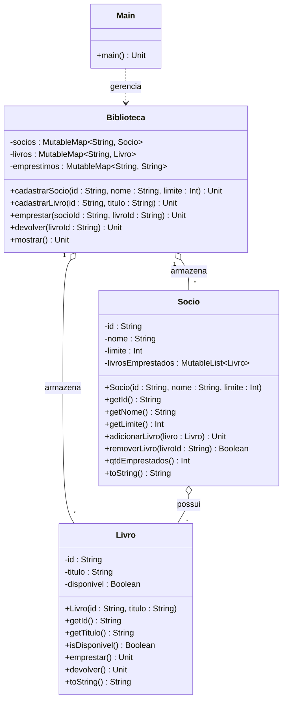

# [TRAIN] Biblioteca do Bairro

<!-- toc-table -->


## Intro

Dona Mercedes, uma professora aposentada apaixonada por literatura, transformou a antiga garagem de sua casa na biblioteca comunitária da Vila Esperança. Com o tempo, vizinhos começaram a doar exemplares de clássicos e romances contemporâneos, atraindo leitores assíduos de todas as idades. Porém, o controle das retiradas feito em um caderno com capa de espiral virou um caos: sócios esqueciam livros emprestados por meses, outros retiravam mais livros do que podiam ler de uma vez, e leitores ficavam frustrados ao procurar no armário livros que constavam como disponíveis, mas já haviam sido levados.

Para salvar o acervo e organizar as regras da biblioteca, você foi convidado a desenvolver um sistema seguro em Kotlin que controle rigorosamente os exemplares, os sócios e seus empréstimos.

### Classes e Responsabilidades

1. **`Livro`**: Representa uma obra do acervo.
   - **Atributos**:
     - `id: String` (identificador único da obra, somente leitura).
     - `titulo: String` (título da obra, somente leitura).
     - `disponivel: Boolean` (privado para modificação direta; indica se o exemplar pode ser retirado).
   - **Métodos**:
     - `emprestar(): Unit`: marca o livro como indisponível. Lança `IllegalStateException("book not available")` se o livro já estiver emprestado.
     - `devolver(): Unit`: marca o livro como disponível. Lança `IllegalStateException("book not loaned")` se o livro já estiver disponível.
     - `toString(): String`: formata no padrão `livro: <id>, <titulo>, disponivel: <disponivel>`.

2. **`Socio`**: Representa um membro cadastrado da biblioteca.
   - **Atributos**:
     - `id: String` (identificador único do sócio, somente leitura).
     - `nome: String` (nome do sócio, somente leitura).
     - `limite: Int` (quantidade máxima de empréstimos ativos simultâneos; deve ser maior que 0, validado no construtor com `IllegalArgumentException("invalid limit")`).
     - `livrosEmprestados: MutableList<Livro>` (privado; lista de livros atualmente em posse do sócio).
   - **Métodos**:
     - `adicionarLivro(livro: Livro): Unit`: adiciona um exemplar à lista de empréstimos do sócio. Lança `IllegalStateException("socio reached loan limit")` caso a quantidade de empréstimos ativos já seja igual ou superior ao limite.
     - `removerLivro(livroId: String): Boolean`: remove o livro da lista do sócio se presente, retornando `true` se foi removido ou `false` se não estava com este sócio.
     - `qtdEmprestados(): Int`: retorna o total de livros atualmente emprestados ao sócio.
     - `toString(): String`: formata no padrão `socio: <id>, <nome>, limite: <limite>, emprestados: <qtd>`.

3. **`Biblioteca`**: Centraliza os acervos e as operações da instituição.
   - **Atributos**:
     - `socios: MutableMap<String, Socio>` (associa o `id` do sócio à sua instância).
     - `livros: MutableMap<String, Livro>` (associa o `id` do livro à sua instância).
     - `emprestimos: MutableMap<String, String>` (associa o `id` do livro ao `id` do sócio que o retirou).
   - **Métodos**:
     - `cadastrarSocio(id: String, nome: String, limite: Int): Unit`: lança `IllegalArgumentException("socio already exists")` se o id já estiver cadastrado.
     - `cadastrarLivro(id: String, titulo: String): Unit`: lança `IllegalArgumentException("book already exists")` se o id já estiver cadastrado.
     - `emprestar(socioId: String, livroId: String): Unit`: realiza o empréstimo vinculando o sócio ao livro. Lança `IllegalArgumentException("socio not found")` se o sócio não existir e `IllegalArgumentException("book not found")` se o livro não existir. Valida as regras de disponibilidade e limite; caso alguma falhe, o estado de ambos os objetos e dos mapas deve permanecer íntegro.
     - `devolver(livroId: String): Unit`: devolve o exemplar ao acervo. Lança `IllegalArgumentException("book not found")` se o livro não existir e `IllegalStateException("book not loaned")` se o livro não estiver registrado como emprestado.
     - `mostrar(): Unit`: imprime todos os sócios e todos os livros cadastrados na ordem de inserção.

4. **`Main`**: Processa a entrada do usuário através de um laço interativo, invocando os métodos do domínio e capturando exceções com `try/catch` para imprimir mensagens de erro no formato `fail: <mensagem>`.

## Regras

- Atributos críticos de estado e controle devem possuir visibilidade privada (`private` ou `private set`), respeitando o encapsulamento.
- Nenhuma classe de domínio (`Livro`, `Socio`, `Biblioteca`) deve utilizar `println` para reportar erros; todas as violações de regras de negócio devem lançar exceções apropriadas.
- O limite de empréstimos de um sócio deve ser obrigatoriamente um valor inteiro estritamente positivo (> 0).
- Um livro emprestado não pode ser emprestado novamente até ser devolvido.
- Se uma operação de empréstimo falhar (por exemplo, por exceder o limite do sócio), a disponibilidade do livro não pode ser alterada e o sistema deve preservar o estado anterior intacto.
- As buscas por sócios e livros devem utilizar mapas com chave única pelo identificador (`id`).
- Todas as mensagens de erro capturadas na camada de interação (`Main`) devem seguir o padrão `fail: <motivo>`.

## Diagrama



## Guide

* **Passo 1**: Crie a classe `Livro`. Implemente seu construtor recebendo `id` e `titulo`, inicializando `disponivel` como `true`. Garanta que `disponivel` tenha `private set` e implemente `emprestar()` e `devolver()`, lançando `IllegalStateException` quando a transição de estado for inválida.
* **Passo 2**: Crie a classe `Socio`. Valide no `init` se `limite > 0`, lançando `IllegalArgumentException("invalid limit")` caso contrário. Implemente a lista interna de livros emprestados e o método `adicionarLivro()`, garantindo que não ultrapasse o limite.
* **Passo 3**: Crie a classe `Biblioteca` com mapas (`linkedMapOf` para preservar a ordem de inserção). Implemente as operações de cadastro, empréstimo e devolução, garantindo que o mapa de empréstimos e os objetos `Socio` e `Livro` sejam mantidos em sincronia. Lembre-se: em caso de falha de validação, reverta ou não altere nenhum estado intermediário.
* **Passo 4**: Construa a classe `Main` com o laço de leitura de comandos (`add_socio`, `add_livro`, `emprestar`, `devolver`, `show`, `end`). Envolva a chamada das operações em um bloco `try/catch` para capturar `IllegalArgumentException` e `IllegalStateException` e exibir `fail: ${e.message}`.

Perguntas de reflexão:
1. Por que manter o mapa `emprestimos` relacionando o ID do livro ao ID do sócio na classe `Biblioteca` simplifica a operação de devolução quando apenas o `id` do livro é fornecido?
2. O que aconteceria se o método `livro.emprestar()` fosse chamado antes de validar se o sócio atingiu o limite de retiradas, caso não houvesse reversão?

## Shell

```bash
#TEST_CASE cadastro_e_exibicao

$add_socio s1 Ana 2
$add_livro l1 Dom_Casmurro
$add_livro l2 O_Guarani
$show
socio: s1, Ana, limite: 2, emprestados: 0
livro: l1, Dom_Casmurro, disponivel: true
livro: l2, O_Guarani, disponivel: true
$end
```

```bash
#TEST_CASE emprestimo_sucesso

$add_socio s1 Ana 2
$add_livro l1 Dom_Casmurro
$emprestar s1 l1
$show
socio: s1, Ana, limite: 2, emprestados: 1
livro: l1, Dom_Casmurro, disponivel: false
$end
```

```bash
#TEST_CASE falha_livro_indisponivel

$add_socio s1 Ana 2
$add_socio s2 Bruno 2
$add_livro l1 Dom_Casmurro
$emprestar s1 l1
$emprestar s2 l1
fail: book not available
$show
socio: s1, Ana, limite: 2, emprestados: 1
socio: s2, Bruno, limite: 2, emprestados: 0
livro: l1, Dom_Casmurro, disponivel: false
$end
```

```bash
#TEST_CASE falha_limite_excedido

$add_socio s1 Ana 1
$add_livro l1 Dom_Casmurro
$add_livro l2 O_Guarani
$emprestar s1 l1
$emprestar s1 l2
fail: socio reached loan limit
$show
socio: s1, Ana, limite: 1, emprestados: 1
livro: l1, Dom_Casmurro, disponivel: false
livro: l2, O_Guarani, disponivel: true
$end
```

```bash
#TEST_CASE devolucao_e_novo_emprestimo

$add_socio s1 Ana 1
$add_livro l1 Dom_Casmurro
$add_livro l2 O_Guarani
$emprestar s1 l1
$devolver l1
$emprestar s1 l2
$show
socio: s1, Ana, limite: 1, emprestados: 1
livro: l1, Dom_Casmurro, disponivel: true
livro: l2, O_Guarani, disponivel: false
$end
```

```bash
#TEST_CASE fronteiras_e_entidades_inexistentes

$add_socio s1 Carlos 0
fail: invalid limit
$add_socio s1 Carlos -2
fail: invalid limit
$emprestar s1 l1
fail: socio not found
$add_socio s1 Carlos 1
$emprestar s1 l1
fail: book not found
$devolver l1
fail: book not found
$add_livro l1 Capitães_da_Areia
$devolver l1
fail: book not loaned
$add_livro l1 Outro_Livro
fail: book already exists
$add_socio s1 Outro_Carlos 2
fail: socio already exists
$end
```

<!-- MERMAID -->