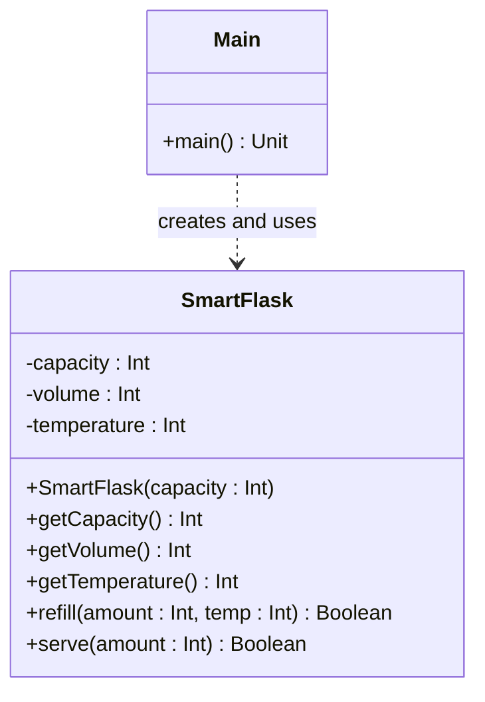

# [TRAIN] Garrafa Térmica Inteligente

<!-- toc-table -->


## Intro

Na cafeteria automatizada *CyberBrew*, a engenheira de sistemas Sofia foi chamada para resolver um incidente delicado: o protótipo de garrafa térmica conectada transbordou café fervendo na bancada dos clientes devido a uma falha no firmware anterior, que permitia receber comandos de abastecimento sem checar os limites físicos do recipiente. Além disso, quando o reservatório esvaziava, o painel continuava exibindo temperaturas de 90°C em um recipiente com ar frio, confundindo os sensores e assustando os baristas.

Para garantir segurança total, Sofia decidiu reformular a lógica interna do dispositivo criando a classe de domínio `SmartFlask`. Todas as variáveis de estado devem ser estritamente protegidas contra acesso direto externo. As operações de abastecer (`refill`) e servir (`serve`) atuam como guardiãs do estado interno: elas analisam os dados recebidos e, caso qualquer invariante seja violada, recusam a operação preservando os valores anteriores e informando o insucesso por meio de um retorno booleano. Dessa forma, cabe exclusivamente à interface de controle (`Shell`) exibir os alertas ao usuário, mantendo a classe de domínio desacoplada e livre de impressões no console.

### Estrutura da Classe `SmartFlask`

- **Atributos privados:**
  - `capacity: Int` — capacidade máxima suportada pelo recipiente em mililitros.
  - `volume: Int` — volume atual de líquido contido em mililitros (inicializa com 0).
  - `temperature: Int` — temperatura atual do líquido em graus Celsius (inicializa com 0).
- **Construtor:**
  - `SmartFlask(capacity: Int)` — recebe e define a capacidade máxima da garrafa.
- **Métodos de consulta (Getters):**
  - `getCapacity(): Int` — retorna a capacidade máxima.
  - `getVolume(): Int` — retorna o volume atual de líquido.
  - `getTemperature(): Int` — retorna a temperatura registrada.
- **Métodos de operação:**
  - `refill(amount: Int, temp: Int): Boolean` — valida e executa o abastecimento de líquido.
  - `serve(amount: Int): Boolean` — valida e executa a retirada de líquido para servir.

### Comandos do Shell

- `init capacity` — instancia uma nova garrafa térmica com a capacidade indicada.
- `show` — exibe o estado atual da garrafa no formato: `flask: <volume>/<capacity>ml, <temp>°C`.
- `refill amount temp` — tenta abastecer a garrafa; caso a operação seja rejeitada, exibe `fail: invalid refill`.
- `serve amount` — tenta servir o líquido; caso a operação seja rejeitada, exibe `fail: invalid serve`.
- `end` — finaliza a execução do programa.

## Regras

- A classe `SmartFlask` deve manter todos os seus atributos estritamente privados (`private`).
- A classe de domínio não deve realizar nenhuma operação de entrada ou saída (`println`, `print`, `Scanner` ou `readLine`).
- No método `refill(amount: Int, temp: Int)`, a quantidade `amount` deve ser estritamente positiva (`amount > 0`).
- No método `refill(amount: Int, temp: Int)`, a temperatura `temp` deve ser estritamente positiva (`temp > 0`).
- No método `refill(amount: Int, temp: Int)`, o novo volume total (`volume + amount`) não pode ultrapassar a `capacity`.
- Se qualquer condição de abastecimento for violada, nenhum atributo é alterado e o método retorna `false`.
- Em caso de abastecimento válido, o `volume` é incrementado por `amount`, a `temperature` passa a ser `temp` e o método retorna `true`.
- No método `serve(amount: Int)`, a quantidade a servir deve ser estritamente positiva (`amount > 0`).
- No método `serve(amount: Int)`, a quantidade a servir não pode exceder o líquido disponível (`amount <= volume`).
- Se qualquer condição de servir for violada, nenhum atributo é alterado e o método retorna `false`.
- Em caso de retirada válida, o `volume` é decrementado por `amount` e o método retorna `true`.
- Caso o `volume` atinja exatamente `0` após servir, a `temperature` deve ser redefinida para `0`.
- O laço principal (`Main`) é o único encarregado de imprimir mensagens de falha e informações de estado.

## Diagrama



## Guide

* Passo 1: Crie a classe `SmartFlask` declarando os atributos `capacity`, `volume` e `temperature` como `private`. Implemente o construtor recebendo a capacidade e garanta que `volume` e `temperature` iniciem com valor `0`.
* Passo 2: Implemente os métodos de consulta (`getCapacity`, `getVolume` e `getTemperature`). Crie o método `refill(amount: Int, temp: Int)` aplicando a técnica de *guard clauses*: verifique primeiro se `amount <= 0`, `temp <= 0` ou se `volume + amount > capacity`. Se qualquer teste falhar, retorne `false` imediatamente sem alterar o estado. Só atualize `volume` e `temperature` após todas as validações passarem.
* Passo 3: Implemente o método `serve(amount: Int)` validando se `amount <= 0` ou `amount > volume`. Caso a retirada seja válida, subtraia `amount` de `volume`. Verifique em seguida se `volume == 0` para zerar a `temperature` antes de retornar `true`.
* Passo 4: No arquivo principal (`Main`), monte o laço de leitura de comandos com `split(" ")`. Trate os comandos `init`, `show`, `refill`, `serve` e `end`. Ao chamar `refill` ou `serve`, verifique o retorno booleano para exibir `fail: invalid refill` ou `fail: invalid serve` caso a operação seja recusada.

Perguntas de reflexão:
- Por que a técnica de validar todas as falhas antes de alterar qualquer atributo (*guard clauses*) torna o código mais seguro contra estados corrompidos?
- Qual é o problema de colocar mensagens de erro diretamente dentro dos métodos de negócio de uma classe de domínio como `SmartFlask`?
- Como o encapsulamento protege as regras de negócio caso outro programador tente manipular diretamente o atributo `volume`?

## Shell

```bash
#TEST_CASE inicializacao_e_abastecimento

$init 1000
$show
flask: 0/1000ml, 0°C
$refill 500 80
$show
flask: 500/1000ml, 80°C
$end
```

```bash
#TEST_CASE prevencao_transbordamento

$init 500
$refill 300 75
$show
flask: 300/500ml, 75°C
$refill 300 70
fail: invalid refill
$show
flask: 300/500ml, 75°C
$end
```

```bash
#TEST_CASE servir_e_esvaziar

$init 600
$refill 400 90
$show
flask: 400/600ml, 90°C
$serve 150
$show
flask: 250/600ml, 90°C
$serve 250
$show
flask: 0/600ml, 0°C
$end
```

```bash
#TEST_CASE tentativas_invalidas_servir

$init 500
$refill 200 85
$serve 300
fail: invalid serve
$serve 0
fail: invalid serve
$serve -50
fail: invalid serve
$show
flask: 200/500ml, 85°C
$end
```

```bash
#TEST_CASE validacao_abastecimento_e_limites

$init 1000
$refill -100 80
fail: invalid refill
$refill 400 0
fail: invalid refill
$refill 400 65
$show
flask: 400/1000ml, 65°C
$refill 600 70
$show
flask: 1000/1000ml, 70°C
$refill 1 70
fail: invalid refill
$show
flask: 1000/1000ml, 70°C
$end
```

<!-- MERMAID -->