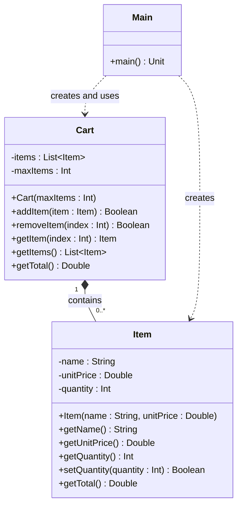

# [TRAIN] Carrinho de Padaria Artesanal

<!-- toc-table -->


## Intro

Dona Clara é mestre padeira e proprietária da acolhedora padaria "Pão Dourado". Famosa por seus pães de fermentação natural, croissants folhados e brioches artesanais, a demanda por suas fornadas diárias disparou. No entanto, sua produção é estritamente artesanal: o forno a lenha tem capacidade reduzida e cada cliente tem cotas para evitar que atravessadores comprem todos os produtos logo cedo.

Para manter a ordem e a justiça entre os fregueses, Dona Clara pediu ao seu sobrinho Lucas, estudante de computação, que desenvolvesse o terminal do caixa de atendimento. No sistema, cada item adicionado possui um lote mínimo de 1 e no máximo 20 unidades. Além disso, as cestas de compras têm limite rígido de tipos de produtos distintos cadastrados para garantir o giro rápido do balcão.

Você deve implementar o modelo orientado a objetos dessa solução contendo duas classes fundamentais:

1. **`Item`**:
   - Representa um produto artesanal selecionado pelo cliente.
   - **Atributos:**
     - `val name: String`: nome do produto.
     - `val unitPrice: Double`: preço unitário.
     - `private var quantity: Int`: quantidade do produto, inicializada com o valor padrão `1`.
   - **Métodos:**
     - `getName(): String`: retorna o nome do item.
     - `getUnitPrice(): Double`: retorna o preço unitário do item.
     - `getQuantity(): Int`: retorna a quantidade atual do produto.
     - `setQuantity(quantity: Int): Boolean`: valida a invariante de negócio. Se a nova quantidade for maior ou igual a `1` e menor ou igual a `20`, atualiza o atributo e retorna `true`. Caso contrário, mantém a quantidade anterior inalterada e retorna `false`.
     - `getTotal(): Double`: calcula e retorna o subtotal do item (`unitPrice * quantity`).

2. **`Cart`**:
   - Representa o carrinho de compras que abriga a lista linear de produtos.
   - **Atributos:**
     - `private val items: MutableList<Item>`: coleção linear privada de itens inseridos.
     - `private val maxItems: Int`: capacidade máxima de itens distintos que a cesta suporta.
   - **Construtor:**
     - Recebe `maxItems: Int` e inicializa a lista interna vazia.
   - **Métodos:**
     - `addItem(item: Item): Boolean`: adiciona um novo item ao final da lista se o número atual de itens for estritamente menor que `maxItems` e retorna `true`. Se a lista estiver cheia, rejeita a adição e retorna `false`.
     - `removeItem(index: Int): Boolean`: remove o item situado na posição `index` caso o índice seja válido (`0 <= index < items.size`) e retorna `true`. Se o índice for inválido, retorna `false`.
     - `getItem(index: Int): Item?`: retorna a referência do item no índice indicado ou `null` caso o índice esteja fora dos limites válidos.
     - `getItems(): List<Item>`: expõe a lista para leitura imutável.
     - `getTotal(): Double`: calcula e retorna a soma dos totais de todos os itens contidos no carrinho.

---

## Regras

- As classes `Item` e `Cart` não devem realizar operações de entrada ou saída no console (`println` / `print`).
- A invariante de `Item` restringe a quantidade ao intervalo fechado `[1, 20]`. Valores menores que 1 ou maiores que 20 devem ser rejeitados retornando `false`.
- A lista de itens em `Cart` deve ser rigorosamente encapsulada (`private`).
- O carrinho não pode conter mais itens que o limite estabelecido por `maxItems`.
- Apenas a interface de comando (`Main`) é responsável por ler os dados, acionar as classes e imprimir as saídas ou mensagens de falha.
- Formatações de moeda devem utilizar sempre duas casas decimais no padrão ponto flutuante americano (`Locale.US`).

---

## Diagrama



---

## Guide

* **Passo 1:** Crie a classe `Item`. Torne o atributo `quantity` privado com valor inicial `1`. No método `setQuantity(quantity: Int): Boolean`, implemente a verificação `if (quantity in 1..20)`. Se verdadeira, atualize o atributo e retorne `true`; caso contrário, preserve o estado atual e retorne `false`. O método `getTotal()` deve calcular `unitPrice * quantity`.
* **Passo 2:** Crie a classe `Cart`. Inicialize o atributo `items` como `mutableListOf<Item>()`. No método `addItem`, verifique se o tamanho da lista é menor que `maxItems` antes de inserir.
* **Passo 3:** Implemente `removeItem` e `getItem` na classe `Cart`, garantindo que o índice recebido esteja no intervalo de posições válidas (`0 until items.size`). Em `getTotal()`, percorra os itens acumulando os valores de `item.getTotal()`.
* **Passo 4:** Na função `main`, monte o interpretador de comandos em um laço de repetição. Processe as entradas, invoque os métodos e trate os retornos booleanos e nulos imprimindo as mensagens correspondentes em caso de erro (`fail: invalid quantity`, `fail: cart is full`, `fail: invalid index`).

Perguntas de reflexão:
1. Por que é preferível que o método `setQuantity` retorne um valor booleano em vez de imprimir a mensagem de erro diretamente dentro da classe `Item`?
2. Se o atributo `items` da classe `Cart` fosse público, como um desenvolvedor desatento poderia corromper a regra de capacidade máxima (`maxItems`)?

---

## Shell

```bash
#TEST_CASE adicao_e_total

$init 3
$add baguette 3.50 2
$add croissant 5.00 3
$show
[0] baguette: 2 x 3.50 = 7.00
[1] croissant: 3 x 5.00 = 15.00
total: 22.00
$end
```

```bash
#TEST_CASE invariante_quantidade

$init 2
$add sourdough 12.00 0
fail: invalid quantity
$add sourdough 12.00 25
fail: invalid quantity
$add sourdough 12.00 2
$set_qty 0 -1
fail: invalid quantity
$set_qty 0 30
fail: invalid quantity
$show
[0] sourdough: 2 x 12.00 = 24.00
total: 24.00
$set_qty 0 4
$show
[0] sourdough: 4 x 12.00 = 48.00
total: 48.00
$end
```

```bash
#TEST_CASE limite_capacidade

$init 2
$add brioche 6.00 1
$add focaccia 8.50 2
$add pretzel 4.00 1
fail: cart is full
$show
[0] brioche: 1 x 6.00 = 6.00
[1] focaccia: 2 x 8.50 = 17.00
total: 23.00
$end
```

```bash
#TEST_CASE remocao_e_indices

$init 3
$add cookie 2.50 4
$add muffin 4.00 2
$remove -1
fail: invalid index
$remove 2
fail: invalid index
$set_qty 5 2
fail: invalid index
$remove 0
$show
[0] muffin: 2 x 4.00 = 8.00
total: 8.00
$end
```

```bash
#TEST_CASE esvaziando_carrinho

$init 2
$show
total: 0.00
$add sonho 3.00 5
$show
[0] sonho: 5 x 3.00 = 15.00
total: 15.00
$remove 0
$show
total: 0.00
$remove 0
fail: invalid index
$end
```

<!-- MERMAID -->