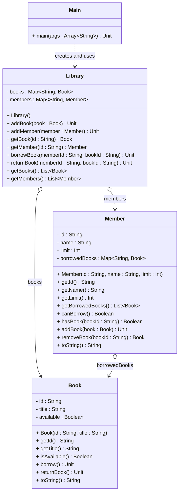

# [TRAIN] Biblioteca de Bairro

<!-- toc-table -->


## Intro

Dona Clara e Seu Antônio fundaram a *Biblioteca Comunitária Girassol* em uma sala anexa à associação de moradores do bairro. Durante anos, todo o controle do acervo e dos leitores foi feito à mão em cadernos de capa dura. Com o crescimento do número de moradores e de doações de livros, a confusão se instalou: leitores retinham dezenas de obras por meses a fio, outros procuravam livros que constavam como guardados na prateleira mas já estavam emprestados, e fichas de papel se perdiam.

Para preservar o projeto comunitário e garantir que todos tenham acesso justo às obras, você foi convidado a desenvolver o núcleo do sistema de gerenciamento da biblioteca. O software deve manter o acervo de livros e o cadastro de sócios, garantindo que nenhum leitor ultrapasse sua cota de empréstimos e que exemplares já emprestados não sejam cedidos novamente até a devolução.

O sistema é estruturado em três classes fundamentais:

### Classe `Book`
Representa um exemplar do acervo.
- **Atributos**:
  - `id: String`: identificador único do livro.
  - `title: String`: título da obra.
  - `available: Boolean`: estado de disponibilidade do exemplar (inicia como `true`).
- **Construtor**:
  - Recebe `id` e `title`. O atributo `available` inicia com o valor `true`.
- **Métodos**:
  - `getId(): String`: retorna o identificador do livro.
  - `getTitle(): String`: retorna o título do livro.
  - `isAvailable(): Boolean`: retorna `true` se o livro estiver disponível para empréstimo.
  - `borrow()`: valida se o livro está disponível. Se não estiver, lança `IllegalStateException("fail: livro indisponivel")`. Caso contrário, altera `available` para `false`.
  - `returnBook()`: valida se o livro está emprestado. Se já estiver disponível, lança `IllegalStateException("fail: livro ja disponivel")`. Caso contrário, altera `available` para `true`.
  - `toString(): String`: retorna a representação no formato `"$id: $title ($status)"`, onde status é `disponivel` ou `emprestado`.

### Classe `Member`
Representa um leitor associado à biblioteca.
- **Atributos**:
  - `id: String`: identificador único do sócio.
  - `name: String`: nome do leitor.
  - `limit: Int`: quantidade máxima de livros que o sócio pode manter emprestados simultaneamente.
  - `borrowedBooks: MutableMap<String, Book>`: mapa de livros atualmente em posse do sócio, indexados pelo `id` do livro.
- **Construtor**:
  - Recebe `id`, `name` e `limit`. Valida se `limit > 0`; caso contrário, lança `IllegalArgumentException("fail: limite invalido")`.
- **Métodos**:
  - `getId(): String`, `getName(): String`, `getLimit(): Int`.
  - `getBorrowedBooks(): List<Book>`: retorna a lista de livros emprestados (valores do mapa).
  - `canBorrow(): Boolean`: retorna `true` se a quantidade atual de empréstimos for menor que `limit`.
  - `hasBook(bookId: String): Boolean`: verifica se o sócio possui o livro indicado pelo ID.
  - `addBook(book: Book)`: valida se o leitor atingiu a sua cota máxima. Se `!canBorrow()`, lança `IllegalStateException("fail: limite de emprestimos atingido")`. Caso contrário, insere o livro no mapa de empréstimos do sócio.
  - `removeBook(bookId: String): Book`: verifica se o sócio possui o livro. Se não possuir, lança `IllegalStateException("fail: socio nao possui este livro")`. Caso possua, remove e retorna o livro.
  - `toString(): String`: retorna a representação no formato `"$id: $name [$count/$limit] -> [$ids]"`, onde `$count` é a quantidade atual de livros emprestados e `$ids` é a lista de IDs dos livros separados por vírgula e espaço (ex: `s1: Ana [1/2] -> [101]`).

### Classe `Library`
Gerencia o catálogo de livros e o quadro de sócios.
- **Atributos**:
  - `books: MutableMap<String, Book>`: mapa com todos os livros cadastrados, indexados por `id`.
  - `members: MutableMap<String, Member>`: mapa com todos os sócios cadastrados, indexados por `id`.
- **Construtor**:
  - Não recebe parâmetros; inicializa os mapas vazios.
- **Métodos**:
  - `addBook(book: Book)`: cadastra um livro. Se o ID já existir em `books`, lança `IllegalArgumentException("fail: livro ja cadastrado")`.
  - `addMember(member: Member)`: cadastra um sócio. Se o ID já existir em `members`, lança `IllegalArgumentException("fail: socio ja cadastrado")`.
  - `getBook(id: String): Book`: busca um livro por ID. Se não encontrar, lança `IllegalArgumentException("fail: livro nao encontrado")`.
  - `getMember(id: String): Member`: busca um sócio por ID. Se não encontrar, lança `IllegalArgumentException("fail: socio nao encontrado")`.
  - `borrowBook(memberId: String, bookId: String)`:
    1. Localiza o sócio usando `getMember(memberId)`.
    2. Localiza o livro usando `getBook(bookId)`.
    3. Valida se o livro está disponível. Se não estiver, lança `IllegalStateException("fail: livro indisponivel")`.
    4. Valida se o sócio pode pegar mais livros (`member.canBorrow()`). Se não puder, lança `IllegalStateException("fail: limite de emprestimos atingido")`.
    5. Executa `book.borrow()` e `member.addBook(book)`.
  - `returnBook(memberId: String, bookId: String)`:
    1. Localiza o sócio usando `getMember(memberId)`.
    2. Localiza o livro usando `getBook(bookId)`.
    3. Remove o livro do sócio com `member.removeBook(bookId)`.
    4. Atualiza o estado do exemplar chamando `book.returnBook()`.
  - `getBooks(): List<Book>`: retorna a lista de livros na ordem em que foram cadastrados.
  - `getMembers(): List<Member>`: retorna a lista de sócios na ordem em que foram cadastrados.

---

## Regras

- Todo livro inicia no estado disponível (`available = true`).
- Um livro não pode ser emprestado se já estiver indisponível.
- Um sócio não pode pegar empréstimos se já atingiu o seu limite configurado (`limit`).
- Tentativas de cadastrar IDs duplicados de livros ou sócios devem lançar `IllegalArgumentException`.
- Tentativas de buscar entidades inexistentes devem lançar `IllegalArgumentException`.
- A devolução exige que o livro de fato esteja registrado em posse daquele sócio.
- Nenhuma operação inválida deve corromper o estado dos objetos ou dos mapas.

---

## Diagrama



---

## Guide

* **Passo 1**: Crie a classe `Book`. Mantenha os atributos privados e implemente os métodos de transição de estado (`borrow` e `returnBook`) usando `check` ou `if` lançando `IllegalStateException`.
* **Passo 2**: Crie a classe `Member`. No construtor, valide o limite com `require(limit > 0)`. Utilize um `LinkedHashMap` para guardar os livros emprestados e garantir ordem previsível. Implemente `canBorrow`, `addBook` e `removeBook`.
* **Passo 3**: Crie a classe `Library`. Utilize mapas para armazenar o acervo e os membros. Nos métodos `getBook` e `getMember`, lance `IllegalArgumentException` caso a chave não esteja presente.
* **Passo 4**: Implemente as operações de orquestração `borrowBook` e `returnBook` em `Library`. Valide as pré-condições antes de alterar os estados para não deixar dados inconsistentes.
* **Passo 5**: Construa a função `main` para processar os comandos do shell, capturar exceções com blocos `try/catch` e imprimir as mensagens de erro na saída padrão.

Perguntas de reflexão:
1. Por que a verificação de disponibilidade deve ser garantida dentro da classe `Book` e não apenas na classe controladora `Library`?
2. Se a chamada `book.borrow()` fosse executada depois de `member.addBook(book)` e falhasse, qual efeito colateral ocorreria na aplicação?

---

## Shell

```bash
#TEST_CASE cadastro

$addBook 101 O_Principe
$addBook 102 1984
$addMember s1 Ana 2
$addMember s2 Beto 1
$books
101: O_Principe (disponivel)
102: 1984 (disponivel)
$members
s1: Ana [0/2] -> []
s2: Beto [0/1] -> []
$end
```

```bash
#TEST_CASE emprestimos_sucesso

$addBook 101 O_Principe
$addBook 102 1984
$addMember s1 Ana 2
$borrow s1 101
$books
101: O_Principe (emprestado)
102: 1984 (disponivel)
$members
s1: Ana [1/2] -> [101]
$borrow s1 102
$members
s1: Ana [2/2] -> [101, 102]
$end
```

```bash
#TEST_CASE devolucoes

$addBook 101 O_Principe
$addBook 102 1984
$addMember s1 Ana 2
$borrow s1 101
$borrow s1 102
$members
s1: Ana [2/2] -> [101, 102]
$return s1 101
$books
101: O_Principe (disponivel)
102: 1984 (emprestado)
$members
s1: Ana [1/2] -> [102]
$return s1 102
$members
s1: Ana [0/2] -> []
$end
```

```bash
#TEST_CASE limite_e_indisponibilidade

$addBook 101 O_Principe
$addMember s1 Beto 1
$addMember s2 Carlos 1
$borrow s1 101
$borrow s2 101
fail: livro indisponivel
$addBook 102 1984
$borrow s1 102
fail: limite de emprestimos atingido
$members
s1: Beto [1/1] -> [101]
s2: Carlos [0/1] -> []
$end
```

```bash
#TEST_CASE validacoes_e_falhas

$addBook 101 O_Principe
$addBook 101 Outro_Livro
fail: livro ja cadastrado
$addMember s1 Ana 0
fail: limite invalido
$addMember s1 Ana 2
$addMember s1 Ana_Duplicada 3
fail: socio ja cadastrado
$borrow s99 101
fail: socio nao encontrado
$borrow s1 999
fail: livro nao encontrado
$return s1 101
fail: socio nao possui este livro
$borrow s1 101
$return s1 999
fail: livro nao encontrado
$return s99 101
fail: socio nao encontrado
$end
```

```bash
#TEST_CASE ciclo_completo

$addBook b1 Dune
$addBook b2 Neuromancer
$addMember m1 Lucas 1
$borrow m1 b1
$books
b1: Dune (emprestado)
b2: Neuromancer (disponivel)
$members
m1: Lucas [1/1] -> [b1]
$return m1 b1
$borrow m1 b2
$books
b1: Dune (disponivel)
b2: Neuromancer (emprestado)
$members
m1: Lucas [1/1] -> [b2]
$end
```

<!-- MERMAID -->